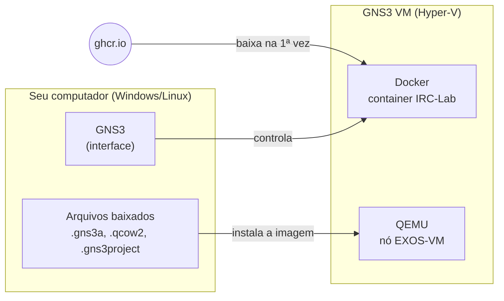
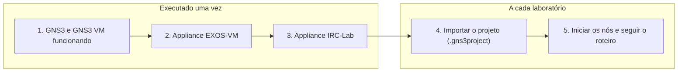
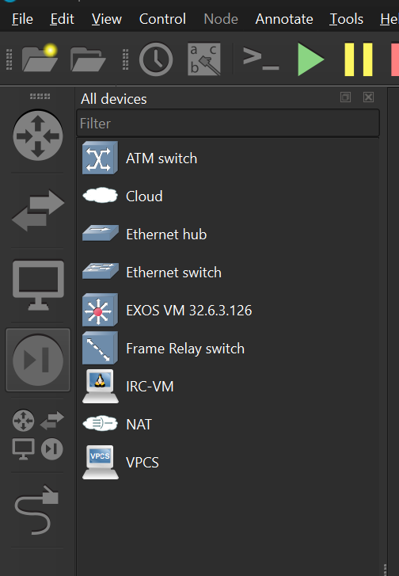

# Preparação do ambiente: GNS3, appliances e projetos

Este tutorial deixa o seu computador pronto para todos os laboratórios que usam o GNS3. Ele é feito **uma única vez**. Depois dele, cada laboratório se resume a importar um arquivo de projeto.

## O que você vai fazer

- Importar no GNS3 o appliance **IRC-Lab**, que dá a cada nó Linux as ferramentas da disciplina (iperf, tshark, Python, FRRouting e outras).
- Testar o ambiente com um nó em um projeto em branco e entender por que a primeira execução demora.
- Importar o appliance **EXOS-VM**, o switch virtual usado a partir do Módulo 03.
- Entender como cada laboratório chega até você: um arquivo de projeto que se importa em um passo.

## Antes de começar

- [ ] GNS3 na versão **2.2.61** instalado. (Testei como GNS3 VM no HyperV)
- [ ] Os arquivos da disciplina: o appliance `irc-lab.gns3a`, o appliance do EXOS-VM e a imagem do EXOS-VM (arquivo `.qcow2`). Os links estão nos passos abaixo.

## Visão geral

Antes de iniciar vamos esclarecer alguns termos:

| Termo | O que é |
|---|---|
| **Appliance** | Arquivo `.gns3a` que ensina o GNS3 a criar um tipo de dispositivo (nome da imagem, número de interfaces, tipo de console). Não contém a imagem em si. |
| **Template** | O dispositivo já cadastrado na sua lista, resultado de importar o appliance. |
| **Projeto** | Uma topologia, com nós (cópias dos templates) e ligações. |


O GNS3 tem duas partes. A interface roda no seu SO, mas os nós rodam dentro da **GNS3 VM**. Por isso as imagens são instaladas **na VM**.




Desse modo o ambiente que consideraremos nessa disciplina será:



## 2. Importar o appliance EXOS-VM

Os switches e roteadores dos laboratórios são nós **EXOS-VM**: a versão virtual do ExtremeXOS, o mesmo sistema operacional dos switches físicos do laboratório. 
Os switches são máquinas virtuais QEMU, e o GNS3 **não** baixa a imagem sozinho. Você baixa o arquivo `.qcow2` e o assistente o instala.

Vocês já devem ter importado. Lembrando que o tutoria está no arquivo [`install-gns3-exos.md`](install-gns3-exos.md).


> [!WARNING]
> **Nome e versão precisam ser idênticos.** Os projetos dos laboratórios procuram a imagem pelo nome do arquivo. Se você importar outra versão, ou renomear o arquivo, a importação do projeto falha. Use exatamente `EXOS-VM_v32.6.3.126.qcow2`.

### testar o EXOS-VM

Para testar o siga o [`tutorial-gns3-extreme.md`](tutorial-gns3-extreme.md)


## 3. Importar o appliance IRC-Lab

1. Baixe o arquivo [`irc-lab-appliance.gns3a`](irc-lab-appliance.gns3a).
2. No GNS3, abra `File > Import appliance` e selecione o arquivo.
3. Em `Server`, escolha `GNS3 VM`.Pois os container Docker rodam na VM, não no Windows.
4. Avance pelas telas do assistente sem alterar os valores padrão, até concluir.
5. Na barra lateral, clique em `Browse all devices` e procure `IRC-Lab` na lista.



O dispositivo `IRC-VM` aparece na lista e o assistente terminou sem mensagem de erro em vermelho.

> [!NOTE]
>
> O arquivo guarda só a receita: o nome da imagem (`ghcr.io/ccufcg/irc-lab:1.0`), 4 interfaces de rede e console por telnet. A imagem em si ainda **não** foi baixada. Isso acontece na primeira vez que você usa o dispositivo, no primeiro uso (próxima etapa).

### Testar com um nó em um projeto em branco

1. Crie um projeto novo: `File > New blank project`, com o nome `teste-ambiente`.
2. Arraste o dispositivo `IRC-VM` da lista para a área de trabalho.
3. Aguarde o nó aparecer na topologia. **Na primeira vez isso demora.**

> [!WARNING]
> 
> **A primeira vez demora.** Neste momento a GNS3 VM baixa a imagem do `ghcr.io`. Dependendo da rede, o GNS3 pode parecer parado por vários minutos. Espere o nó aparecer. Não arraste outro nó nem feche o programa.
>
> Se aparecer erro de tempo esgotado (*timeout*), aguarde alguns minutos e arraste o dispositivo de novo: a VM costuma continuar o download, e a segunda tentativa encontra a imagem pronta. Nas próximas vezes, o nó aparece na hora.

> [!TIP]
> **Baixar a imagem antes, pelo SSH.** Se a sua rede é lenta, faça o download direto na VM e só depois arraste o nó. O IP da GNS3 VM aparece na tela da VM. Usuário e senha padrão: `gns3` e `gns3`, a menos que você os tenha alterado.
>
> ```powershell
> ssh gns3@<IP-da-GNS3-VM>
> docker pull ghcr.io/ccufcg/irc-lab:1.0
> ```

**Iniciar o nó e conferir as ferramentas**

1. Inicie o nó: botão direito sobre ele e `Start` (ou o botão verde da barra de ferramentas). O ponto ao lado do nome fica verde.
2. Abra o console: duplo clique no nó (ou botão direito e `Console`). Abre um terminal.
3. Execute os comandos abaixo.

```bash
pwd
irc-ajuda
irc-teste
```

### Teste opcional, 5 minutos: dois nós conversando

Arraste um segundo `IRC-VM`, ligue os dois pela `eth0` com a ferramenta de cabo (`Add a link`), inicie ambos e abra os consoles.

No nó A:

```bash
ip addr add 10.0.0.1/24 dev eth0
ip link set eth0 up
```

No nó B:

```bash
ip addr add 10.0.0.2/24 dev eth0
ip link set eth0 up
ping -c 3 10.0.0.1
```


## Dinamica dos laboratórios 

Cada laboratório é distribuído com um **projeto** `LAB_xx.gns3project`, com a topologia pronta (nós, ligações e nomes).

O arquivo de projeto é pequeno porque **não carrega imagens**: ele usa os appliances que você importou nas partes anteriores. 

### Importar o projeto de um laboratório (vale para todos os labs)

1. Baixe o arquivo `LAB_xx.gns3project`.
2. No GNS3, abra `File > Import portable project` e selecione o arquivo.
3. Confirme o nome do projeto e conclua. A topologia abre pronta.
4. Inicie os nós (`Start all nodes`), abra os consoles e siga o roteiro.

> **Erro de imagem ao importar.** Se a importação reclamar de imagem ou template não encontrado para o EXOS-VM, o appliance da Parte 3 não foi importado, ou o arquivo tem nome ou versão diferente do indicado. Volte à Parte 3.

### Guardando o seu trabalho

- `Ctrl+S` salva o projeto.
- `File > Export portable project` gera um arquivo para backup ou para enviar ao professor.
- Nos nós EXOS-VM, grave a configuração com `save configuration`, senão ela se perde ao desligar o nó.
- Nos nós IRC-VM, guarde scripts e arquivos externos.

<!-- > **Topologias próprias: pasta persistente.** Nos projetos distribuídos pelo professor nada precisa ser ajustado. Se você criar uma topologia sua com o IRC-Lab, confirme uma vez que `/root/lab` sobrevive ao reinício do nó: em `Edit > Preferences > Docker > Docker containers`, selecione `IRC-Lab`, `Edit`, aba `Advanced`, e escreva `/root/lab` na caixa de diretórios persistentes (um por linha). Vale para nós criados depois da alteração. -->

