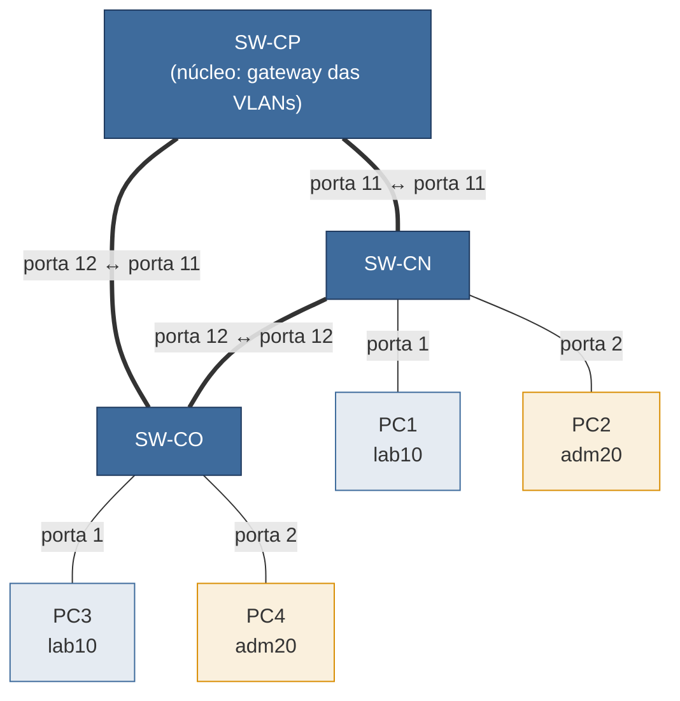
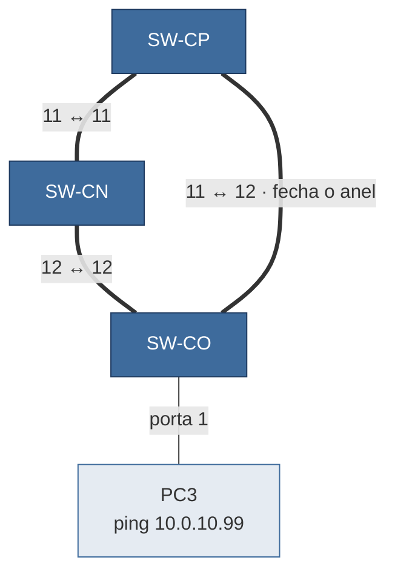
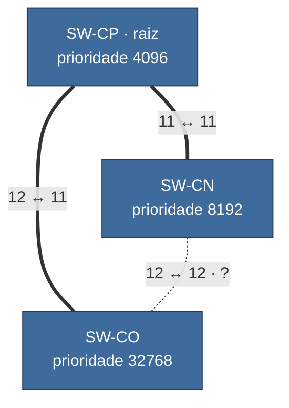
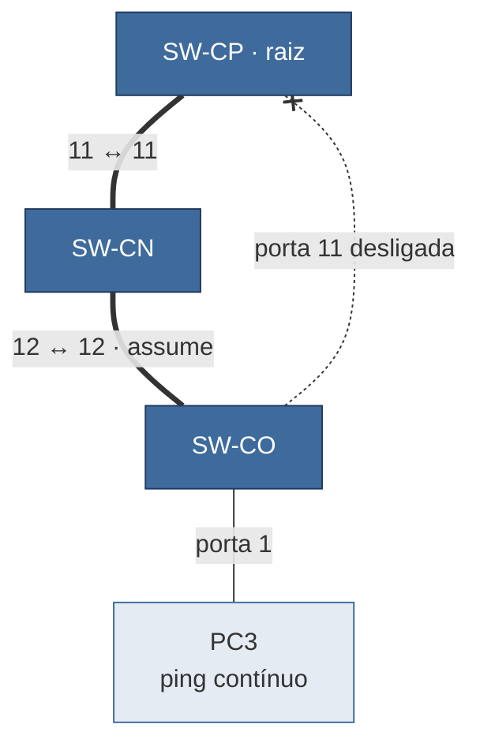
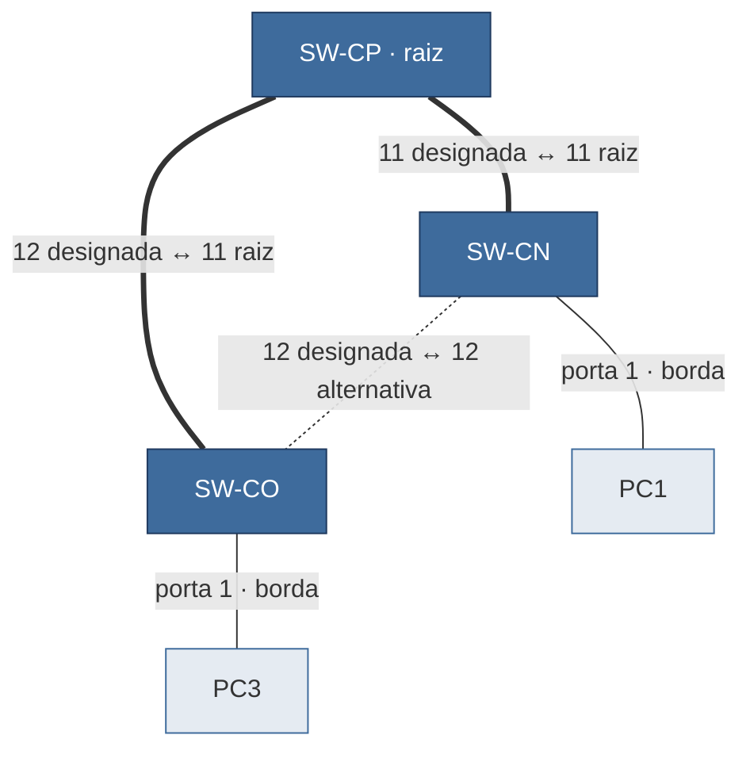
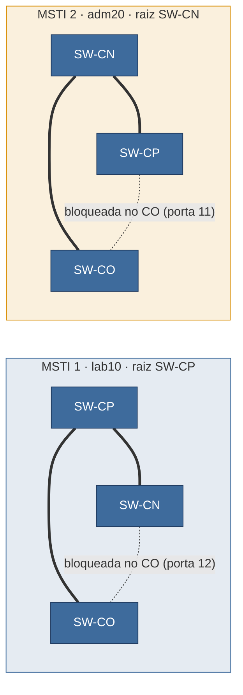
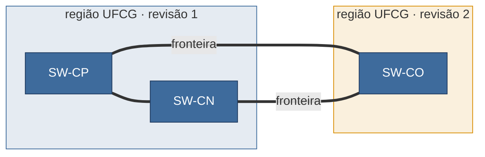

<!-- PROFESSOR: legenda deste roteiro (não aparece para o aluno na renderização)
  - Portas: as mesmas dos slides da 11A (aulas/modulo3/stp/0-estilos.tex). Anel: CP:11↔CN:11, CN:12↔CO:12, CO:11↔CP:12. Hosts: porta 1 (lab10) e porta 2 (adm20) no SW-CN e no SW-CO. São uma proposta: se o projeto do GNS3 usar outras, trocar aqui e nos slides [fragile].
  - O projeto cenarios/11A-anel.gns3project foi gerado por script a partir do 9-vlan (mesma definição de EXOS, GNS3 2.2.61) e NÃO foi aberto no GNS3. Conferir uma vez: importa; os três EXOS sobem de fábrica (sem disco próprio, o GNS3 cria um novo); cabos nas portas 1, 2, 11 e 12; VPCS com o IP do startup.vpc; cabo CO–CP vem suspenso.
  - Todas as saídas de equipamento estão como marcadores PROFESSOR: nenhuma foi conferida na EXOS-VM 32.6.
-->

# Guia prático da Aula 11A: redundância em camada 2 (STP, RSTP e MSTP)

Este guia reproduz as demonstrações da aula 11A (*Redundância em camada 2: Spanning Tree*). Ele segue a ordem da aula: cada parte corresponde a um momento em que o professor parou os slides para mostrar no GNS3. Você vai montar um backbone em anel com três switches, ver o que acontece quando o anel fica sem proteção e, depois, comparar como STP, RSTP e MSTP resolvem o problema.

| Parte | O que você vai fazer | Na aula, depois de |
|---|---|---|
| [Preparação](#preparação) | Importar o anel CP–CN–CO e fazer a configuração base | — |
| [1. O anel sem STP](#1-o-anel-sem-stp) | Provocar uma tempestade de broadcast e ver a tabela MAC enlouquecer | Slide *O cenário desta aula*, na abertura |
| [2. A árvore do backbone](#2-a-árvore-do-backbone) | Ligar o STP, descobrir quem virou raiz e escolher a raiz certa | Seção *Spanning Tree Protocol (802.1D)* |
| [3. Derrubando um enlace (802.1D)](#3-derrubando-um-enlace-8021d) | Medir quanto tempo o prédio CO fica sem rede | Seção *Estados e temporizadores* |
| [4. O mesmo teste em RSTP](#4-o-mesmo-teste-em-rstp) | Trocar para RSTP e medir de novo | Seção *Rapid Spanning Tree (802.1w)* |
| [5. MSTP: cada VLAN por um caminho](#5-mstp-cada-vlan-por-um-caminho) | Dar uma raiz diferente a cada VLAN | Seção *Multiple Spanning Tree (802.1s)* |
| [6. Desafio: a região quebrada](#6-desafio-a-região-quebrada) | Mudar um detalhe da região MST e ver a divisão de carga sumir | Slide *Região MST* |

O guia leva cerca de 2 h, contando o tempo que os três EXOS levam para subir. As partes são **cumulativas**: cada uma começa do estado em que a anterior terminou.

> **Dica:** antes de cada parte, tire um *snapshot* no GNS3 (*Edit → Manage snapshots*). Se algo der errado, você volta ao início da parte em vez de recomeçar tudo. O snapshot do fim da parte 4 (`fim-rstp`) é o ponto de partida da aula 11B: não pule esse.

> ⚠️ **Atenção:** a parte 1 provoca de propósito um laço de camada 2. Faça isso **apenas no GNS3**. Num laboratório ou numa rede de verdade, o mesmo teste derruba o prédio inteiro.

---

## Preparação

### O cenário

Três prédios ligados em anel. O **SW-CP** é o núcleo: é nele que ficam os gateways das VLANs. Os enlaces do anel são troncos e carregam as duas VLANs da aula 9.



É um backbone **simplificado**, inspirado no campus: não é a topologia real da rede da UFCG. Os nomes, endereços e portas são os mesmos dos slides.

### Plano de endereçamento

As VLANs e sub-redes são as da aula 9:

| VLAN | Nome | VID | Sub-rede | Gateway (no SW-CP) |
|---|---|---|---|---|
| Laboratório | `lab10` | 10 | `10.0.10.0/24` | `10.0.10.1` |
| Administrativo | `adm20` | 20 | `10.0.20.0/24` | `10.0.20.1` |

| Host | Switch / porta | VLAN | IP |
|---|---|---|---|
| PC1 | SW-CN / 1 | `lab10` | `10.0.10.21/24` |
| PC2 | SW-CN / 2 | `adm20` | `10.0.20.22/24` |
| PC3 | SW-CO / 1 | `lab10` | `10.0.10.31/24` |
| PC4 | SW-CO / 2 | `adm20` | `10.0.20.32/24` |

| Enlace do anel | Porta de um lado | Porta do outro lado |
|---|---|---|
| CP–CN | SW-CP, porta 11 | SW-CN, porta 11 |
| CN–CO | SW-CN, porta 12 | SW-CO, porta 12 |
| CO–CP | SW-CO, porta 11 | SW-CP, porta 12 |

No GNS3, a interface `PortN` do EXOS-VM corresponde à porta N do switch. A interface `Mgmt` não é usada neste guia.

### Importando o cenário

1. No GNS3, importe o projeto `11A-anel`, em [`../cenarios/`](../cenarios/): *File → Import portable project*.
2. Ele já vem montado: os três EXOS, de fábrica, os quatro PCs (VPCS) com os IPs da tabela e os cabos nas portas das tabelas. Os números das portas aparecem nos cabos.
3. O cabo **CO–CP vem suspenso** (desenhado de outro jeito no GNS3): é o anel **aberto**. Não mexa nele ainda; o passo seguinte explica.

Cada EXOS ocupa cerca de 1 GB de RAM. Feche outros projetos do GNS3 antes de começar.

### Acessando os equipamentos

1. Inicie todos os nós (▶ verde). O EXOS leva alguns minutos para subir; espere aparecer o prompt de login.
2. Clique duas vezes num nó para abrir o console.
3. No **EXOS**, o usuário é `admin` e a senha é vazia (só tecle Enter). Se o switch perguntar sobre desabilitar Telnet, SNMP, portas não configuradas ou alterar a conta *failsafe*, responda `n` a todas as perguntas.
4. No **VPCS**, o prompt é o nome do PC (`PC1>`).

### Ponto de partida: o anel aberto

Os três switches sobem de fábrica, com todas as portas na VLAN `Default`. Se os três cabos do anel estivessem ativos, já haveria um laço antes de você configurar qualquer coisa. Por isso o cabo CO–CP vem suspenso.

Agora troque a forma de manter o anel aberto: em vez do cabo suspenso, a porta desligada. No **SW-CO**:

```
disable port 11
```

Depois, no GNS3, clique com o botão direito no cabo CO–CP → *Resume*. O cabo volta, mas a porta 11 do SW-CO continua desligada: o anel segue **aberto**, agora por configuração. É o passo 2 da Demo 1 do slide *Fechando o anel sem proteção*. Na parte 1, um `enable port 11` fecha o anel.

> Se você reaproveitar switches de outro projeto, volte-os antes ao padrão de fábrica com `unconfigure switch all` (o switch pede confirmação e reinicia).

### Configuração base: VLANs, troncos e gateway

É a preparação do cenário: estes comandos não aparecem nos slides.

**Nos três switches** (VLANs e troncos do anel):

```
create vlan lab10 tag 10
create vlan adm20 tag 20
configure vlan Default delete ports 11,12
configure vlan lab10 add ports 11,12 tagged
configure vlan adm20 add ports 11,12 tagged
```

**No SW-CN e no SW-CO** (portas dos hosts):

```
configure vlan Default delete ports 1,2
configure vlan lab10 add ports 1
configure vlan adm20 add ports 2
```

**No SW-CP** (o gateway de cada VLAN):

```
configure vlan lab10 ipaddress 10.0.10.1/24
configure vlan adm20 ipaddress 10.0.20.1/24
```

Os troncos são **só etiquetados**: as portas 11 e 12 saem da `Default` e entram como `tagged` nas duas VLANs. É o bloco *Só etiquetadas (recomendado)* da aula 9.

**Nos PCs:** eles já vêm com o IP da tabela. Confira em cada um:

```
PC1> show ip
```

Se o IP não estiver lá, configure à mão (e grave com `save`):

```
PC1> ip 10.0.10.21/24 10.0.10.1
PC2> ip 10.0.20.22/24 10.0.20.1
PC3> ip 10.0.10.31/24 10.0.10.1
PC4> ip 10.0.20.32/24 10.0.20.1
```

Confira, com o anel ainda aberto:

```
PC3> ping 10.0.10.1
PC4> ping 10.0.20.1
```

**Resultado esperado:** os dois respondem. O PC3 e o PC4 chegam ao SW-CP passando pelo SW-CN, porque a porta 11 do SW-CO (o caminho direto) está desligada.

Confira também o estado do STP de fábrica, em qualquer switch:

```
show stpd
show stpd s0
```

<!-- PROFESSOR: colar aqui a saída real de "show stpd s0" num EXOS de fábrica (pendência já anotada em 1-motivacao.tex e no gabarito da UASC) -->

Tire um snapshot: `inicio`.

---

## 1. O anel sem STP

**Objetivo:** ver o que acontece com uma rede Ethernet em anel quando nada controla o laço.

O quadro Ethernet não tem TTL, o switch inunda broadcast por todas as portas e o aprendizado supõe que cada MAC esteja atrás de uma única porta. Em um anel, essas três regras produzem as três falhas mostradas na abertura da aula, logo depois da demonstração: **tempestade de broadcast**, **tabela MAC instável** e **quadros duplicados**.



> ⚠️ **Tenha o comando de parada pronto.** Deixe o console do SW-CO aberto com `disable port 11` já digitado. Se o console não responder, use o GNS3: botão direito no cabo CO–CP → *Suspend* (o mesmo estado em que ele veio no projeto). Em último caso, pare o SW-CO (■).

### 1.1 Desligar o STP nos três switches

Seja qual for o estado de fábrica, vamos garantir que nada proteja o anel. **Nos três switches:**

```
disable stpd s0
```

Confira com `show stpd s0`.

**O que procurar:** o domínio `s0` aparece como desabilitado.

<!-- PROFESSOR: colar aqui a saída real de "show stpd s0" com o domínio desabilitado -->

### 1.2 Anotar os contadores antes

No **SW-CP**, veja os contadores das portas do anel e anote os valores de broadcast recebido:

```
show ports 11,12 statistics
```

<!-- PROFESSOR: confirmar o nome da coluna de broadcast recebido (Rx Bcast?) e se a tela se atualiza sozinha; se atualizar, explicar ao aluno como sair dela (ou usar "show ports 11,12 statistics no-refresh", avisando que difere do slide) -->

No PC3, anote o MAC dele:

```
PC3> show ip
```

### 1.3 Fechar o anel e gerar um broadcast

No **SW-CO**, feche o anel:

```
enable port 11
```

No **PC3**, peça um endereço que não existe na rede:

```
PC3> ping 10.0.10.99
```

Como ninguém tem o IP `10.0.10.99`, o PC3 fica repetindo a pergunta ARP *quem tem 10.0.10.99?*, que é um **broadcast**.

<!-- PROFESSOR: confirmar que o VPCS repete o ARP a cada tentativa de ping para um endereço inexistente -->

### 1.4 Observar

No **SW-CP**, repita duas ou três vezes, com alguns segundos de intervalo:

```
show ports 11,12 statistics
show fdb
```

**O que procurar:**
- **Tempestade:** os contadores de broadcast das portas 11 e 12 sobem muito mais depressa do que um ping por segundo explicaria. Um único broadcast basta: ele gira pelo anel para sempre, nos dois sentidos.
- **Tabela MAC instável:** a cada `show fdb`, o MAC do PC3 (na VLAN `lab10`) pode aparecer numa porta diferente, ora na 12 (direto do SW-CO), ora na 11 (dando a volta pelo SW-CN).
- Se o console ficar lento para responder, isso também faz parte do resultado: na máquina virtual, o switch gasta a CPU repassando as cópias.

<!-- PROFESSOR: colar aqui a saída real de "show ports 11,12 statistics" antes e durante o laço, e duas saídas de "show fdb" com o MAC do PC3 em portas diferentes -->

### 1.5 Parar o laço

No **SW-CO**:

```
disable port 11
```

Repita o `show ports 11,12 statistics` no SW-CP.

**Resultado esperado:** os contadores param de subir. Com o anel aberto, as cópias saem da rede na primeira volta incompleta, e a rede volta ao normal.

### Para pensar

1. O PC3 parou de pingar, mas, se você não tivesse aberto o anel, a tempestade pararia sozinha?
2. O laço aconteceu na VLAN `lab10`. O broadcast do PC3 chegou à VLAN `adm20`? E o PC4, que está na `adm20`, poderia ter sido prejudicado mesmo assim?

<details>
<summary>Respostas</summary>

1. Não. O quadro Ethernet não tem campo de saltos que alguém decremente, então nenhum switch tem motivo para descartá-lo. As duas cópias giram pelo anel até alguém quebrar o laço (ou o switch travar).
2. O broadcast não muda de VLAN: ele circula só na `lab10`. Mas os enlaces do anel e a CPU dos switches são **compartilhados** pelas duas VLANs. Com eles saturados pela `lab10`, o tráfego da `adm20` também sofre. Uma VLAN delimita o domínio de broadcast, não os recursos físicos.

</details>

### Não funcionou? Confira

- Os contadores não disparam → o STP ainda está ligado em algum switch (`show stpd s0`), ou a porta 11 do SW-CO continua desligada (`show ports 11 information`).
- O ping do PC3 não sai → a porta 1 do SW-CO está na `lab10`? (`show vlan lab10`).
- Nada acontece com a `lab10` → as portas 11 e 12 estão como `tagged` na `lab10` nos **três** switches? (`show vlan lab10`).

<!-- PROFESSOR: verificar se a EXOS-VM tem alguma proteção contra laço ligada de fábrica (ELRP, por exemplo) que impeça a tempestade -->

---

## 2. A árvore do backbone

**Objetivo:** ligar o STP, descobrir quem ele escolhe como raiz e, depois, escolher a raiz certa.

O STP mantém os cabos redundantes ligados, mas deixa só um caminho lógico entre quaisquer dois switches: uma **árvore geradora**. Para isso, ele elege uma **raiz** (o menor Bridge ID), escolhe em cada switch a **porta raiz** (o melhor caminho até ela), escolhe em cada enlace a **porta designada**, e **bloqueia** o resto.

### 2.1 Ligar o STP com as prioridades de fábrica

O anel continua aberto (a porta 11 do SW-CO está desligada desde a parte 1). Os comandos são os do slide *STP no EXOS*. **Nos três switches:**

```
disable stpd s0
configure stpd s0 mode dot1d
configure stpd s0 add vlan lab10 ports all
configure stpd s0 add vlan adm20 ports all
enable stpd s0
```

- `mode dot1d` escolhe o STP clássico (802.1D-1998), o assunto desta parte.
- As duas linhas `add vlan` são essenciais no EXOS: o domínio `s0` só protege as VLANs adicionadas a ele. Uma VLAN fora do `s0` continua com o laço livre, mesmo com o STP ligado.

<!-- PROFESSOR: confirmar a sintaxe na EXOS-VM 32.6 (mode dot1d exige o stpd desligado? "add vlan ... ports all" aceita a VLAN com portas tagged?) -->

Só agora, com o STP ligado nos três, feche o anel. No **SW-CO**:

```
enable port 11
```

Espere uns 30 s: no 802.1D, uma porta leva esse tempo para começar a encaminhar.

### 2.2 Quem virou raiz?

Nos três switches:

```
show switch
show stpd s0
```

**O que procurar:**
- em `show switch`, o **MAC do sistema** de cada switch;
- em `show stpd s0`, o **Bridge ID** do próprio switch e o **Root ID** (o Bridge ID da raiz que ele adotou). Os três devem concordar no Root ID.

Com as três prioridades empatadas em 32768, a raiz é o switch de **menor MAC**. Pode ser qualquer um dos três, e não necessariamente o SW-CP.

<!-- PROFESSOR: colar aqui a saída real de "show switch" (linha do System MAC) e de "show stpd s0" -->

### 2.3 Escolher a raiz

A regra do slide *Bridge ID: quem é quem*: para escolher a raiz, mexa **só na prioridade**. A raiz é escolhida, não sorteada pelo MAC. O núcleo vira a raiz e o SW-CN vira a raiz reserva.

**No SW-CP:**

```
configure stpd s0 priority 4096
```

**No SW-CN:**

```
configure stpd s0 priority 8192
```

O SW-CO fica com a prioridade de fábrica.

**Antes de olhar a resposta, preveja no papel:** qual é a porta raiz do SW-CN e a do SW-CO? Qual porta fica bloqueada? Os três enlaces têm a mesma velocidade, e portanto o mesmo custo.



<details>
<summary>Resposta</summary>

| Switch | Porta 11 | Porta 12 |
|---|---|---|
| SW-CP (raiz) | designada | designada |
| SW-CN | **raiz** (vai direto ao CP) | designada |
| SW-CO | **raiz** (vai direto ao CP) | **bloqueada** |

- Todas as portas da raiz são designadas.
- O SW-CN e o SW-CO chegam ao CP pela porta 11, com o custo de um enlace. Pela porta 12, dariam a volta, com o dobro do custo.
- No enlace CN–CO, os dois oferecem o mesmo custo até a raiz (um enlace). O empate é decidido pelo Bridge ID, e o do SW-CN (8192) é menor que o do SW-CO (32768). A porta do CN é a designada e a do CO, que sobrou, bloqueia.

</details>

### 2.4 Conferir

Nos três switches:

```
show stpd s0 ports
```

**O que procurar:** o estado de cada porta do anel. A porta 12 do SW-CO deve estar **bloqueada**, e todas as outras portas do anel encaminhando.

<!-- PROFESSOR: colar aqui a saída real de "show stpd s0 ports" nos três switches; confirmar se o modo dot1d mostra o papel (raiz/designada) além do estado -->

### 2.5 Ver as BPDUs

No GNS3, clique com o botão direito no cabo **CN–CO** → *Start capture*. No Wireshark, use o filtro:

```
stp
```

**O que procurar:**
- **Quem envia:** só aparecem BPDUs vindas de **um** lado do enlace, o do SW-CN (a porta designada). Uma porta bloqueada recebe BPDUs, mas não as envia.
- Abra uma BPDU. Em *Protocol Version Identifier* deve aparecer *Spanning Tree (0)*. Em *Root Identifier*, a prioridade 4096 e o MAC do SW-CP. Em *Bridge Identifier*, a prioridade 8192 e o MAC do SW-CN.
- O intervalo entre BPDUs é o *hello*: 2 s.

<!-- PROFESSOR: confirmar no Wireshark que o s0 envia BPDU nas portas 11/12 mesmo com elas fora da Default (pendência de 2-stp.tex) -->

### 2.6 Testar

```
PC3> ping 10.0.10.1
PC1> ping 10.0.10.31
```

**Resultado esperado:**
- PC3 → gateway: **responde**, pelo caminho direto CO–CP.
- PC1 → PC3: **responde**. Os dois estão na mesma VLAN, mas o enlace CN–CO está bloqueado, então o caminho entre eles passa pelo SW-CP.
- Nenhum contador dispara: o anel continua fisicamente fechado, mas logicamente é uma árvore.

### Para pensar

1. Com as prioridades de fábrica (passo 2.2), por onde ia o tráfego do PC3 até o gateway? Esse caminho fazia sentido para o projeto?
2. O PC1 e o PC3 estão em switches vizinhos, ligados por um cabo direto. Por que o ping entre eles dá a volta pelo SW-CP?

<details>
<summary>Respostas</summary>

1. Depende de quem ganhou no MAC. Se a raiz não era o SW-CP, a porta bloqueada pode ter caído justamente num enlace do núcleo, e o tráfego do prédio até o gateway dava uma volta desnecessária. É o caso do exercício dos slides, em que o SW-CN virou raiz e o enlace CO–CP ficou parado.
2. Porque o STP otimiza o caminho **até a raiz**, não entre quaisquer dois switches. A árvore tem uma só ligação ativa entre o CN e o CO, e ela passa pelo CP. É um preço do STP: alguns caminhos entre vizinhos ficam mais longos do que o cabo permitiria.

</details>

### Não funcionou? Confira

- Todas as portas aparecem bloqueadas ou em escuta → espere 30 s depois do `enable stpd s0` ou do `enable port 11`.
- Os três switches não concordam no Root ID → um deles está com o STP desligado ou em outro modo (`show stpd s0`).
- O ping funciona, mas os contadores de broadcast disparam → uma das VLANs ficou fora do `s0` em algum switch. Abra o anel (`disable port 11` no SW-CO) e confira o `add vlan` nos três.

---

## 3. Derrubando um enlace (802.1D)

**Objetivo:** medir quanto tempo o prédio CO fica sem rede quando o enlace com o núcleo cai, e quanto tempo leva para voltar.

Quando a porta raiz do SW-CO cai, a porta bloqueada (a 12) precisa assumir. No 802.1D, ela não encaminha na hora: passa por **escuta** (15 s) e **aprendizado** (15 s). É o *Forward Delay*, duas vezes.



### 3.1 Ping contínuo

```
PC3> ping 10.0.10.1 -t
```

O `-t` deixa o ping rodando até você teclar `Ctrl+C`.

<!-- PROFESSOR: confirmar que o VPCS da versão usada aceita "-t"; se não aceitar, usar "ping 10.0.10.1 -c 120" -->

### 3.2 Derrubar o enlace CO–CP

No **SW-CO**:

```
disable port 11
```

Logo em seguida, repita algumas vezes, também no SW-CO:

```
show stpd s0 ports
```

**O que procurar:** a porta 12 sai do bloqueio e passa por **escuta** (*listening*), depois **aprendizado** (*learning*) e, por fim, **encaminhamento** (*forwarding*).

<!-- PROFESSOR: colar aqui as saídas reais de "show stpd s0 ports" com a porta 12 em escuta e em aprendizado -->

### 3.3 Contar

No PC3, conte as respostas perdidas (as linhas de *timeout*) até o ping voltar.

**Resultado esperado:** algo perto de **30 pings perdidos** (um por segundo). É uma **falha direta**: o próprio SW-CO viu a porta 11 cair e partiu direto para a porta 12, e restaram os dois *Forward Delay*.

Anote o valor: ele vai para a tabela da parte 4.

<!-- PROFESSOR: preencher com o número real de pings perdidos no GNS3 -->

### 3.4 Religar

Com o ping ainda rodando, no **SW-CO**:

```
enable port 11
```

Conte de novo.

**Resultado esperado:** o ping **para outra vez**, por um tempo parecido.

### 3.5 A porta do usuário

Este teste não está nos slides, mas ilustra o slide *E a porta do usuário?*. Deixe um ping contínuo no PC1:

```
PC1> ping 10.0.10.1 -t
```

No **SW-CN**, desligue e religue a porta do PC1, como se alguém tirasse e recolocasse o cabo:

```
disable port 1
enable port 1
```

**Resultado esperado:** depois do `enable`, o PC1 fica uns **30 s** sem resposta. A porta de um PC passa pela mesma escuta e pelo mesmo aprendizado de uma porta entre switches: o 802.1D não tem como saber que ali há só um computador. Num PC que pede endereço por DHCP, esse é o tempo em que o pedido fica sem resposta.

### 3.6 Para ir além: a falha indireta

Repita os passos 3.1 a 3.3, mas derrube o enlace **do outro lado**, no SW-CP (a porta 12 dele é a ponta CP do enlace CO–CP):

```
disable port 12
```

Agora quem precisa reagir é o SW-CO, e ele **não vê** a própria porta cair: o cabo virtual continua "ligado" do lado dele. Ele só percebe porque as BPDUs da raiz param de chegar pela porta 11. Antes de refazer a conta, ele espera a informação velha expirar: o *Max Age*, de 20 s.

**Resultado esperado:** algo perto de **50 pings perdidos** (20 + 15 + 15).

Desfaça no SW-CP:

```
enable port 12
```

<!-- PROFESSOR: confirmar que, no GNS3, desligar a porta 12 do SW-CP não derruba a porta 11 do SW-CO (sem propagação do estado do enlace). Se derrubar, a falha vira direta (~30 s) e este passo deve sair do roteiro. -->

### Para pensar

1. Por que a **volta** do enlace (passo 3.4) também derruba o ping, se o caminho antigo (pela porta 12) continuava funcionando?
2. No passo 3.5, o PC1 tem um cabo só. Desligar e religar essa porta pode criar um laço?

<details>
<summary>Respostas</summary>

1. Quando a porta 11 volta, o SW-CO recebe por ela uma BPDU melhor (o caminho direto até a raiz). A 11 vira a porta raiz e a 12 volta a bloquear **na hora**, porque bloquear nunca cria laço. A 11, porém, precisa passar por escuta e aprendizado antes de encaminhar. Nesses 30 s, nenhuma das duas encaminha. No 802.1D, mudar de caminho custa caro nos dois sentidos.
2. Não, e é exatamente esse o desperdício: o 802.1D trata a porta de um PC com a mesma cautela de uma porta entre switches. O RSTP resolve isso com a **porta de borda** (parte 4).

</details>

### Não funcionou? Confira

- O ping não volta nunca → a porta 12 do SW-CO ficou bloqueada? (`show stpd s0 ports`). As VLANs estão no `s0` nos três switches?
- O ping volta quase na hora → o STP está mesmo em `dot1d`? (`show stpd s0`, procure o modo).

---

## 4. O mesmo teste em RSTP

**Objetivo:** trocar o STP pelo RSTP e repetir as medições da parte 3.

O RSTP mantém a mesma eleição, mas a porta bloqueada do SW-CO agora tem um papel com nome: **alternativa**, um caminho já calculado até a raiz. Quando a porta raiz cai, a alternativa assume e encaminha na hora. Entre switches, as portas novas não esperam temporizador: negociam com **proposta e acordo**. E as portas de PC podem ser declaradas **de borda**.



### 4.1 Abrir o anel antes de mexer no modo

> ⚠️ **Atenção:** para trocar o modo, o comando começa com `disable stpd s0`. Enquanto o STP de um switch está desligado, as portas dele encaminham tudo. Se o anel estiver fechado nesse momento, você recria a parte 1 sem querer.

No **SW-CO**:

```
disable port 11
```

É o alerta *Abra o anel antes* do slide *RSTP no EXOS*.

### 4.2 Trocar para RSTP

Os comandos são os do slide *RSTP no EXOS*. **Nos três switches:**

```
disable stpd s0
configure stpd s0 mode dot1w
configure stpd s0 ports link-type point-to-point 11,12
enable stpd s0
```

**No SW-CN e no SW-CO** (portas dos hosts):

```
configure stpd s0 ports link-type edge 1,2
```

- `point-to-point` declara que as portas 11 e 12 ligam exatamente dois switches, em full duplex. É o que permite a proposta e o acordo.
- `edge` declara as portas 1 e 2 como portas de borda (de host). Elas encaminham assim que o cabo é ligado.

As VLANs continuam no `s0` e as prioridades (4096 e 8192) se mantêm: só o modo muda.

<!-- PROFESSOR: confirmar a sintaxe dos dois "link-type" na EXOS-VM 32.6 e qual é o link-type padrão -->

### 4.3 Ver a proposta e o acordo

No GNS3, comece uma captura no cabo **CO–CP** (filtro `stp`). Depois, no **SW-CO**, feche o anel:

```
enable port 11
```

**O que procurar:**
- *Protocol Version Identifier: Rapid Spanning Tree (2)*.
- Nas *BPDU flags*, uma BPDU do SW-CP com **Proposal** e, logo depois, uma do SW-CO com **Agreement**. A diferença entre as duas é de milissegundos, não de 30 s.

<!-- PROFESSOR: confirmar em que momento as flags aparecem nesta topologia (sem propagação do estado do enlace, a porta 12 do SW-CP pode não reiniciar a negociação). Se não aparecerem aqui, capturar logo depois do "enable stpd s0" do passo 4.2, em qualquer enlace do anel. -->

### 4.4 Os papéis

No **SW-CO**:

```
show stpd s0 ports
```

**O que procurar:** a porta 11 como **raiz** e a porta 12 como **alternativa** (*alternate*), em descarte. As portas 1 e 2 aparecem como borda.

<!-- PROFESSOR: colar aqui a saída real de "show stpd s0 ports" no SW-CO, em dot1w -->

### 4.5 Medir de novo

Repita os passos 3.1 a 3.4 (ping contínuo do PC3, `disable port 11` e `enable port 11` no SW-CO) e preencha a tabela do slide *O mesmo teste, agora em RSTP*:

| | Queda (pings perdidos) | Volta (pings perdidos) |
|---|---|---|
| STP (parte 3) | | |
| RSTP | | |

**Resultado esperado:** com RSTP, no máximo um ou dois pings perdidos na queda e na volta.

<!-- PROFESSOR: preencher com os valores reais medidos no GNS3 -->

### 4.6 A porta de borda

Repita o passo 3.5 (ping contínuo no PC1, `disable port 1` e `enable port 1` no SW-CN).

**Resultado esperado:** o PC1 volta a responder **assim que a porta é religada**. A porta de borda vai direto para o encaminhamento.

### 4.7 Guardar o estado para a aula 11B

Nos três switches:

```
save configuration
```

Nos PCs, `save`. Salve o projeto e tire o snapshot **`fim-rstp`**. A aula 11B parte daqui.

### Para pensar

1. Por que, no RSTP, a **volta** do enlace também ficou rápida?
2. Se você repetir o passo 3.6 (derrubar do lado do SW-CP), quanto tempo espera agora?
3. Por que só as portas 1 e 2 foram declaradas de borda, e não as portas 11 e 12?

<details>
<summary>Respostas</summary>

1. Porque, quando a porta 11 volta, o SW-CP propõe e o SW-CO aceita assim que se sincroniza (a porta 12 dele volta a descartar). Nenhum temporizador entra na conta: a troca leva o tempo de duas mensagens.
2. Cerca de **6 s**. No RSTP, todo switch envia BPDU a cada *hello*, e a BPDU vira um sinal de vida. Três *hellos* sem BPDU (3 × 2 s) e o vizinho é dado como perdido, no lugar dos 20 s do *Max Age*. Continua mais lento que a falha direta, mas bem melhor que os 50 s do 802.1D.
3. Porque uma porta de borda pula a negociação. Entre switches, isso abriria um laço por alguns instantes, até a primeira BPDU chegar e tirar da porta a condição de borda. Na aula 11B, o **BPDU guard** vai além: desliga a porta de borda que recebe uma BPDU.

</details>

### Não funcionou? Confira

- Continua perdendo ~30 pings → algum switch ficou em `dot1d` (`show stpd s0`). Lembre que uma porta RSTP que ouve BPDU 802.1D volta ao comportamento antigo **naquele enlace**.
- A queda é rápida, mas a volta demora → as portas 11 e 12 estão mesmo como `point-to-point`?
- O PC1 continua esperando 30 s no passo 4.6 → faltou o `link-type edge` no SW-CN.

---

## 5. MSTP: cada VLAN por um caminho

**Objetivo:** dar a cada VLAN uma árvore própria, com raiz própria, para que os três enlaces do anel carreguem tráfego.

Com STP ou RSTP há uma única árvore, e o enlace CN–CO fica parado para as duas VLANs. O MSTP agrupa VLANs em **instâncias** (MSTI), e cada instância tem sua árvore. O plano é o do slide *Nosso plano: cada VLAN com sua raiz*:

| Instância | VLAN | Raiz (4096) | Raiz reserva (8192) |
|---|---|---|---|
| MSTI 1 | `lab10` | SW-CP | SW-CN |
| MSTI 2 | `adm20` | SW-CN | SW-CP |

Os três switches formam uma **região** MST: mesmo nome (`UFCG`), mesma revisão (1) e o mesmo mapeamento de VLANs para instâncias.



### 5.1 Abrir o anel

Pelo mesmo motivo do passo 4.1, no **SW-CO**:

```
disable port 11
```

### 5.2 Região e instâncias

Os comandos são os do slide *MSTP no EXOS (1/2)*, **na ordem, nos três switches:**

```
disable stpd s0
configure mstp region UFCG
configure mstp revision 1
configure stpd s0 mode mstp cist
configure stpd s0 delete vlan lab10 ports all
configure stpd s0 delete vlan adm20 ports all
create stpd s1
configure stpd s1 mode mstp msti 1
configure stpd s1 add vlan lab10 ports all
create stpd s2
configure stpd s2 mode mstp msti 2
configure stpd s2 add vlan adm20 ports all
enable stpd s0
enable stpd s1
enable stpd s2
```

- No EXOS, cada instância é um domínio de STP (`stpd`) próprio. O `s0` vira a **CIST** (instância 0); `s1` e `s2` são as MSTIs 1 e 2.
- Uma VLAN pertence a uma só instância: por isso a `lab10` e a `adm20` saem do `s0` antes de entrar no `s1` e no `s2`.

<!-- PROFESSOR: confirmar na EXOS-VM 32.6 a ordem e a sintaxe; e se o s0 (CIST) precisa ter as portas 11/12 por alguma VLAN (pendência de 5-mstp.tex). Se precisar, acrescentar aqui a VLAN de controle e ajustar o slide. -->

### 5.3 As raízes de cada instância

Os comandos são os do slide *MSTP no EXOS (2/2)*.

**No SW-CP:**

```
configure stpd s1 priority 4096
configure stpd s2 priority 8192
```

**No SW-CN:**

```
configure stpd s1 priority 8192
configure stpd s2 priority 4096
```

O SW-CO fica com as prioridades de fábrica.

Feche o anel. No **SW-CO**:

```
enable port 11
```

### 5.4 Uma alternativa diferente em cada instância

**Antes de olhar, preveja:** em cada instância, qual porta do SW-CO fica como alternativa?

No **SW-CO**:

```
show stpd
show stpd s1 ports
show stpd s2 ports
```

**O que procurar:**
- `s1` (lab10, raiz SW-CP): a porta 11 é raiz e a **12** é alternativa;
- `s2` (adm20, raiz SW-CN): a porta 12 é raiz e a **11** é alternativa.

<!-- PROFESSOR: colar aqui as saídas reais de "show stpd s1 ports" e "show stpd s2 ports" no SW-CO -->

### 5.5 Testar: cada VLAN por um caminho

Comece uma captura no cabo **CO–CP** (sem filtro, ou com o filtro `icmp`). Ao mesmo tempo:

```
PC3> ping 10.0.10.1
PC4> ping 10.0.20.1
```

**Resultado esperado:**
- Os dois pings **respondem**.
- Na captura do CO–CP aparece **só o ping do PC3** (com etiqueta 802.1Q `ID: 10`). O ping do PC4 não passa por ali: na MSTI 2, a porta 11 do SW-CO está bloqueada, e a `adm20` vai do CO ao CP passando pelo SW-CN.
- Se você filtrar por `stp`, as BPDUs agora são *Multiple Spanning Tree (3)*: uma única BPDU carrega a CIST e um registro para cada MSTI.

### Para pensar

1. Se o enlace CN–CO cair agora, o que acontece com cada VLAN?
2. Os três enlaces carregam tráfego. Isso quer dizer que o anel não tem mais porta bloqueada?

<details>
<summary>Respostas</summary>

1. A `lab10` nem percebe: ela já não usava o CN–CO (a porta 12 do CO era alternativa na MSTI 1). A `adm20` perde a porta raiz no SW-CO, e a alternativa dela (a porta 11) assume, como no RSTP. Cada instância reage só ao que muda na **sua** árvore.
2. Não. Cada instância continua sendo uma árvore, com uma porta bloqueada. A diferença é que a porta bloqueada é diferente em cada instância. Por VLAN, continua havendo um caminho só; o ganho é que, somando as VLANs, nenhum cabo fica ocioso.

</details>

### Não funcionou? Confira

- As duas instâncias bloqueiam a mesma porta → as prioridades de `s1` e `s2` ficaram trocadas ou não foram aplicadas (`show stpd s1`, `show stpd s2`).
- Um dos switches parece "fora" da região → nome, revisão ou mapeamento de VLANs diferente dos outros. É o desafio da parte 6.
- Laço (contadores disparando) logo depois do 5.2 → o anel estava fechado durante a troca de modo. Abra o anel, espere os contadores pararem e confira o `show stpd` nos três.

---

## 6. Desafio: a região quebrada

**Objetivo:** ver o que acontece quando um único switch discorda da configuração da região MST.

O slide *Região MST* diz que nome, revisão e mapeamento de VLANs precisam ser **idênticos** em todos os switches da região. Vamos mudar só a revisão de um deles.



### 6.1 Mudar a revisão no SW-CO

No **SW-CO**:

```
configure mstp revision 2
```

<!-- PROFESSOR: confirmar se a EXOS aceita mudar a revisão com os stpd ligados; se exigir, incluir disable/enable (abrindo o anel antes, como na parte 5) -->

### 6.2 Observar

Repita no SW-CO e no SW-CP:

```
show stpd s1 ports
show stpd s2 ports
```

E repita o teste 5.5 (captura no CO–CP, ping do PC3 e do PC4).

**Antes de abrir a resposta, tente explicar o que mudou.**

<!-- PROFESSOR: colar aqui as saídas reais de "show stpd s1 ports" e "show stpd s2 ports" no SW-CO com a revisão 2 -->

<details>
<summary>Resposta</summary>

Com a revisão diferente, o *digest* da configuração que vai na BPDU do SW-CO não bate mais com o dos outros dois. Para eles, o SW-CO passa a ser **outra região**, e os enlaces CN–CO e CO–CP viram **fronteira**.

As MSTIs só existem dentro de uma região. Na fronteira, quem decide é a **CIST** (o `s0`), que é uma árvore só para todas as VLANs. Resultado: as duas VLANs voltam a usar o **mesmo** caminho, e a divisão de carga da parte 5 some. Na captura do CO–CP, o ping do PC4 pode reaparecer, ou o do PC3 sumir, conforme o caminho que a CIST escolher.

Nenhum switch registra erro e a rede continua funcionando. É o tipo de falha que só aparece quando alguém vai investigar por que um enlace está sobrecarregado e o outro, parado.

</details>

### 6.3 Desfazer

No **SW-CO**:

```
configure mstp revision 1
```

Repita o `show stpd s1 ports` e o `show stpd s2 ports`: cada instância deve voltar a ter a sua própria alternativa, como no passo 5.4.

> Para a aula 11B, **volte ao snapshot `fim-rstp`** (parte 4). A 11B parte do anel em RSTP, não em MSTP.

---

## Resumo dos comandos

| Para… | Comando (EXOS) |
|---|---|
| Voltar ao padrão de fábrica | `unconfigure switch all` |
| Desligar / religar uma porta | `disable port <p>` / `enable port <p>` |
| Contadores de uma porta | `show ports <portas> statistics` |
| Tabela MAC | `show fdb` |
| MAC do switch | `show switch` |
| Ligar / desligar o STP | `enable stpd s0` / `disable stpd s0` |
| Modo do STP | `configure stpd s0 mode dot1d` (STP), `dot1w` (RSTP), `mstp cist` (MSTP) |
| Proteger uma VLAN com o STP | `configure stpd s0 add vlan <nome> ports all` |
| Prioridade (raiz) | `configure stpd <stpd> priority <múltiplo de 4096>` |
| Enlace entre switches (RSTP) | `configure stpd s0 ports link-type point-to-point <portas>` |
| Porta de borda (RSTP) | `configure stpd s0 ports link-type edge <portas>` |
| Região MST | `configure mstp region <nome>`, `configure mstp revision <n>` |
| Criar uma instância MSTP | `create stpd <s1>`, `configure stpd <s1> mode mstp msti <n>` |
| Ver o STP | `show stpd`, `show stpd <stpd>`, `show stpd <stpd> ports` |
| Salvar a configuração | `save configuration` |

| Para… | Comando (VPCS) |
|---|---|
| IP fixo | `ip <ip>/<prefixo> <gateway>` |
| Ver IP e MAC | `show ip` |
| Ping contínuo | `ping <ip> -t` (parar com `Ctrl+C`) |
| Salvar | `save` |

| Para… | No GNS3 / Wireshark |
|---|---|
| Capturar num cabo | botão direito no cabo → *Start capture* |
| Só BPDUs | filtro `stp` |
| Só pings | filtro `icmp` |
| Interromper um cabo sem console | botão direito no cabo → *Suspend* (e *Resume* para religar) |
| Voltar a um ponto salvo | *Edit → Manage snapshots* |
