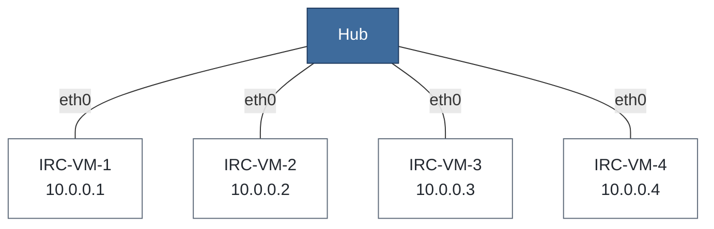

# Guia prático da Aula: o problema do hub

Este guia reproduz as demonstrações da aula 8A (*Switching: Introdução e Arquitetura*). 

## O cenário

Abra o projeto `8A-intro` no GNS3 (pasta [`cenarios`](../cenarios/8A-intro.gns3project)). Os nós usam a imagem Docker `ghcr.io/ccufcg/irc-lab:1.1`, executada na GNS3 VM. A topologia é esta:




As quatro máquinas ligam a `eth0` ao equipamento do meio. 


| Máquina | Endereço | Papel neste guia |
|---|---|---|
| IRC-VM-1 | `10.0.0.1/24` | Servidor web |
| IRC-VM-2 | `10.0.0.2/24` | Cliente |
| IRC-VM-3 | `10.0.0.3/24` | **Intrusa:** não participa da conversa |
| IRC-VM-4 | `10.0.0.4/24` | Reserva (não é usada) |

Os endereços já vêm configurados no projeto.


## Preliminaries

1. Inicie todos os nós (▶ verde).
2. Clique duas vezes numa VM para abrir o console (telnet, em *bash*).
3. Abra **três consoles**: VM-1, VM-2 e VM-3. Você vai alternar entre eles.

### Captura de pacotes do GNS3

Na parte 1 você vai usar o Wireshark pelo GNS3 (botão direito num link → *Start capture*). Ele precisa estar instalado no seu computador e configurado em *Edit → Preferences → Packet capture*. Se não conseguir, o `tcpdump` nas VMs também funciona e está indicado em cada passo.

### Testes iniicial

Verifique se as maquinas estão com os ips designados

```bash
ip -4 addr show eth0
```

Na VM-1 ping as demais VM:

```bash
ping -c 3 10.0.0.2
```

---

## O problema

Vamos montar um cenário comum: a VM-1 publica uma página web e a VM-2 a acessa. A VM-3 não tem nada a ver com isso.


### 1. Crie a página e o servidor

**Na VM-1:**

```bash
cd /root/lab
cat > index.html <<'EOF'
<html>
  <body>
    <h1>Boletim confidencial</h1>
    <p>Esta página era só para a VM-2.</p>
  </body>
</html>
EOF
python3 -m http.server 8000
```

### 2. Escute a interface na VM-3

Escolha **uma** das opções (ou faça as duas).

**Opção A: Wireshark pelo GNS3.** Clique com o botão direito no link entre a **VM-3** e o equipamento do meio e escolha *Start capture*. O Wireshark abre e começa a capturar.

**Opção B: `tcpdump` no console da VM-3.**

```bash
tcpdump -ni eth0 -e -A 'arp or tcp port 8000'
```


### 3. Acesse a página pela VM-2

Com a captura **já ligada**, rode **na VM-2**:

```bash
curl http://10.0.0.1:8000/
```


### 4. Veja o que a VM-3 capturou

**No Wireshark:**

1. Escreva `tcp.port == 8000` no filtro de exibição e tecle Enter.
2. Clique com o botão direito num dos pacotes e escolha *Follow → TCP Stream*.

> O Wireshark não decodifica a porta 8000 como HTTP por padrão. Por isso usamos o filtro `tcp.port == 8000` (e não `http`). O *Follow TCP Stream* funciona do mesmo jeito.

**No `tcpdump`:** o HTML aparece em texto no meio da saída.

**O que procurar:**

- o *handshake* TCP (SYN, SYN+ACK, ACK), o `GET / HTTP/1.0` e a resposta `HTTP/1.0 200 OK`;
- o texto `Boletim confidencial` no fluxo, **na tela da VM-3**;
- na coluna de MAC (ou no `-e`), um endereço de destino que **não é o da VM-3**.


### Para pensar

1. Os quadros que a VM-3 recebeu tinham como destino o MAC da VM-1 ou da VM-2. Por que a placa da VM-3 não os descartou?
2. Se a VM-3 **não** estivesse com o `tcpdump` ligado, ela teria "visto" a conversa?

<details>
<summary>Resposta</summary>

1. O `tcpdump` coloca a placa em **modo promíscuo**, em que ela aceita quadros com qualquer MAC de destino. Sem esse modo, a placa descartaria o quadro por não ser o MAC dela. Mas o quadro **chegou** à VM-3 do mesmo jeito: quem entregou foi o equipamento do meio.
2. Os quadros chegariam à placa da mesma forma, mas o sistema os descartaria sem mostrar nada ao usuário. Quem quer espionar liga o modo promíscuo, o que é trivial. Por isso confiar que "a placa descarta" não é proteção.

</details>


### O que o GNS3 não mostra

O hub do GNS3 é um programa. Ele repete os quadros, mas **não simula colisão nem o CSMA/CD**. Num hub de verdade, duas máquinas transmitindo ao mesmo tempo causariam colisão e retransmissão. Aqui, os dois quadros simplesmente são entregues. A colisão você verá nos slides, não no laboratório.

