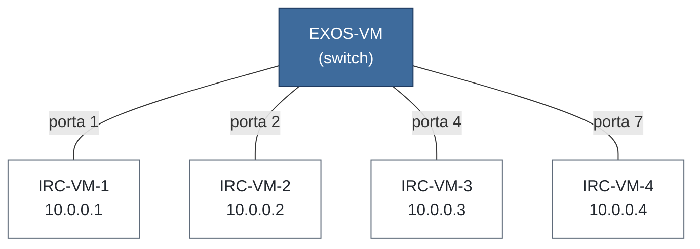
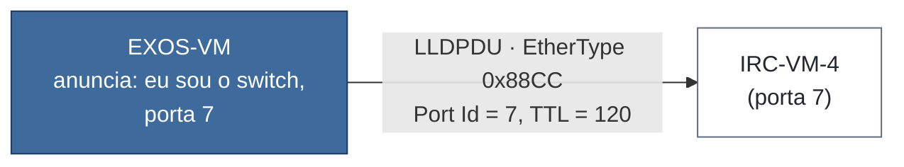
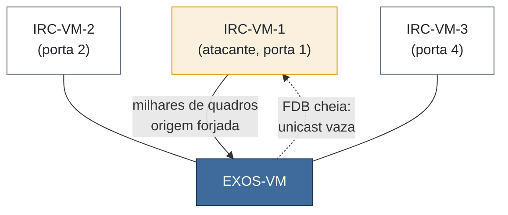
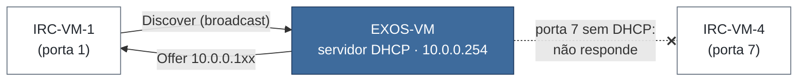
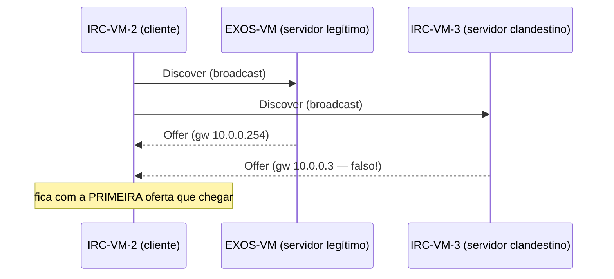

# Guia prático da Aula 08B: descoberta de vizinhos, MAC flooding e DHCP

Este guia reproduz, passo a passo, as demonstrações da aula 08B (*Switching: descoberta de vizinhos*). Ele segue a mesma ordem da aula: cada parte corresponde a um momento em que o professor parou os slides para mostrar no GNS3. Aqui os hosts são **containers Linux** (imagem `irc-lab`), então você usa comandos de Linux (`ip`, `ping`, `tcpdump`, `dhclient`) em vez do VPCS.


- [Preparação](#preparação) :  Abrir o cenário e entender o ponto de partida 
- [1. Quem está do outro lado? (LLDP)](#1-quem-está-do-outro-lado-lldp) : Descobrir o vizinho sem seguir cabo 
- [2. Quando o aprendizado vira ataque (MAC flooding)](#2-quando-o-aprendizado-vira-ataque-mac-flooding) : Encher a FDB e depois barrar o ataque 
- [3. DHCP](#3-dhcp) : Ligar um servidor DHCP no switch e ver o DORA 
- [4. Desafio: servidor DHCP clandestino](#4-desafio-servidor-dhcp-clandestino) : Subir um DHCP falso e vê-lo competir 

Reserve cerca de **1h30**. Faça as partes em ordem: a Parte 3 reaproveita a topologia das anteriores.

> **Dica:** antes de cada parte, tire um *snapshot* no GNS3 (*Edit → Manage snapshots*). Se algo der errado, você volta ao início da parte em vez de recomeçar tudo. Isso vale em dobro para a Parte 2, que mexe no aprendizado de MACs do switch.


## Preparação


Abra o projeto `8B-flood` no GNS3 (esta pasta, `../cenarios/`). A topologia é um único switch EXOS com quatro hosts Linux:



- Há **um só switch**, o EXOS-VM. Tudo é feito nele.
- Os quatro hosts são **containers Linux** (imagem `irc-lab`), com `eth0` ligada ao switch.
- Repare nas portas: 1, 2, 4 e **7**. Elas não são seguidas de propósito — a VM-4 na **porta 7** reaparece nas Partes 1 e 3.

### Plano de endereçamento

No estado inicial do projeto, cada host sobe com um IP fixo em `10.0.0.0/24`:

| Host | Porta no switch | IP inicial (fixo) |
|---|---|---|
| IRC-VM-1 | 1 | `10.0.0.1/24` |
| IRC-VM-2 | 2 | `10.0.0.2/24` |
| IRC-VM-3 | 4 | `10.0.0.3/24` |
| IRC-VM-4 | 7 | `10.0.0.4/24` |

As Partes 1 e 2 (LLDP e MAC flooding) são de camada 2 e usam esses IPs como estão. Na Parte 3 vamos **trocar o IP fixo por DHCP**, e o switch passará a ter o endereço `10.0.0.254` como servidor/gateway.

### Acessando os equipamentos

1. Inicie todos os nós (▶ verde). O EXOS-VM leva alguns minutos para subir; espere aparecer o prompt de login.
2. Clique duas vezes num nó para abrir o console.
3. No **EXOS**, o usuário é `admin` e a senha é vazia (só tecle Enter).
4. Nos **containers**, o console abre direto num shell (`bash`). Os comandos abaixo marcados com `IRC-VM-1#` rodam nesse shell, como `root`.

### Ponto de partida: um único domínio de broadcast

Num EXOS recém-ligado, **todas as portas estão untagged na VLAN `Default`** (VID 1): um switch sem VLAN, um único domínio de broadcast. Confira no switch:

```
show vlan
show ports information
```

**O que procurar:** a VLAN `Default` com todas as portas listadas; as portas 1, 2, 4 e 7 ativas (*Active*).

<!-- PROFESSOR: colar aqui a saída real de "show vlan" do EXOS-VM -->

Gere um pouco de tráfego para o switch aprender os MACs e olhe a tabela de encaminhamento:

```
IRC-VM-1# ping -c 2 10.0.0.2
IRC-VM-1# ping -c 2 10.0.0.3
```

No switch:

```
show fdb
```

**O que procurar:** os MACs dos hosts que já conversaram, cada um associado à sua porta (1, 2, 4). Essa é a **FDB** (*forwarding database*) da aula — guarde esta imagem, ela é o alvo do ataque da Parte 2.

<!-- PROFESSOR: colar aqui a saída real de "show fdb" com os MACs dos containers -->

---

## 1. Quem está do outro lado? (LLDP)

**Objetivo:** fazer o switch anunciar quem é para os vizinhos e conferir, sem seguir cabo, qual host está em qual porta.



### 1.1 Habilitar o LLDP no switch

Por padrão o EXOS fala **EDP** (o primo proprietário da Extreme), não necessariamente o LLDP. Ligue o LLDP em todas as portas:

```
enable lldp ports all
show lldp
```

**O que procurar:** o LLDP habilitado nas portas 1, 2, 4 e 7, enviando anúncios a cada **30 s**.

<!-- PROFESSOR: confirmar na EXOS-VM se LLDP e/ou EDP vêm habilitados por padrão (show lldp / show edp) -->

### 1.2 Ver o anúncio chegar no host (Wireshark)

O anúncio do switch é um quadro Ethernet puro, sem IP. Vamos capturá-lo no host da porta 7. No GNS3, clique com o botão direito no cabo **EXOS-VM ↔ IRC-VM-4** e escolha **Start capture**. Espere até 30 s (o intervalo do LLDP) e filtre no Wireshark por `lldp`.

Como alternativa, direto no container:

```
IRC-VM-4# tcpdump -i eth0 -e -v ether proto 0x88cc
```

**O que procurar:**
- EtherType **`0x88CC`** e destino reservado `01:80:c2:00:00:0e` (quadro consumido pelo switch, nunca repassado);
- os três TLVs obrigatórios: **Chassis ID**, **Port ID** e **TTL**;
- é exatamente a captura que apareceu na motivação da aula: **`Port Id = 7`** (a porta onde esta VM-4 está ligada) e **`TTL = 120`** (4 × 30 s).

<!-- PROFESSOR: colar aqui o resumo do quadro LLDP capturado (Chassis ID, Port Id = 7, TTL = 120) -->

### 1.3 A tabela de vizinhos do switch

```
show lldp neighbors
show lldp neighbors detailed
```

**O que procurar:** se os containers também falam LLDP, cada porta (1, 2, 4, 7) aparece com o nome e a interface do host vizinho. Essa tabela é o que ferramentas de monitoramento usam para desenhar a topologia e conferir o cabeamento do projeto.

<!-- PROFESSOR: confirmar se a imagem irc-lab roda lldpd (senão "show lldp neighbors" fica vazio e a descoberta só funciona no sentido switch -> host, visível na captura 1.2) -->

### 1.4 Testar (positivo e negativo)

Desligue o LLDP numa porta e veja o vizinho sumir:

```
disable lldp ports 7
show lldp neighbors
```

**Resultado esperado:**
- **Positivo:** com o LLDP ligado, o vizinho da porta certa aparece (e/ou o quadro é capturado no host).
- **Negativo:** desligado na porta 7, o switch para de anunciar por ali; a captura em IRC-VM-4 não recebe mais LLDPDUs e, depois do TTL expirar (120 s), o host some da tabela do vizinho.

Religue antes de seguir:

```
enable lldp ports 7
```

### Para pensar

1. O quadro LLDP não tem endereço IP. Como o vizinho o recebe mesmo assim?
2. Por que o anúncio do switch **não** aparece na captura de um host ligado a outro switch três saltos adiante?

<details>
<summary>Respostas</summary>

1. O LLDP vive só na camada 2: é um quadro Ethernet com EtherType `0x88CC`, entregue ao vizinho direto pelo enlace. Não depende de IP, por isso funciona até numa porta ainda sem endereço configurado.
2. O LLDP tem alcance de **um salto**. O destino `01:80:c2:00:00:0e` é um endereço reservado que todo switch **consome e nunca repassa**. O anúncio morre no primeiro vizinho.

</details>

### Não funcionou? Confira

- `show lldp neighbors` vazio → os containers podem não rodar `lldpd`. Confirme a captura da etapa 1.2 (sentido switch → host), que não depende do host falar LLDP.
- Nada na captura → o LLDP está habilitado naquela porta (`show lldp`)? Você esperou o intervalo de 30 s? O filtro do Wireshark é `lldp`?

---

## 2. Quando o aprendizado vira ataque (MAC flooding)

**Objetivo:** mostrar que a FDB é finita e confia cegamente no MAC de origem — e depois fechar o furo com *port security*.

> **Uso responsável.** Esta demonstração só pode ser feita **neste laboratório isolado**. Gerar quadros com MAC forjado em rede de produção ou de terceiros é incidente de segurança e infração. A ferramenta tem limites embutidos (ver 2.3) justamente para manter a demo contida.



Nesta parte, a **IRC-VM-1 (porta 1)** faz o papel de atacante.

### 2.1 Um MAC não é fixo

Antes do ataque em si, confirme a premissa da aula: o MAC de origem é só um padrão de fábrica, trocável por software. Na IRC-VM-1:

```
IRC-VM-1# ip link show eth0
IRC-VM-1# ip link set eth0 down
IRC-VM-1# ip link set eth0 address 02:1a:2b:3c:4d:5e
IRC-VM-1# ip link set eth0 up
IRC-VM-1# ping -c 2 10.0.0.2
```

No switch:

```
show fdb
```

**O que procurar:** o MAC da porta 1 mudou para `02:1a:2b:3c:4d:5e`. Trocar à mão dá **um** endereço forjado; o ataque precisa de milhares, novos a cada quadro, sem reconfigurar a interface.

> Se o `ip link set ... address` falhar com *Operation not permitted*, o container não tem a permissão `NET_ADMIN`. Veja a nota ao professor no fim.

<!-- PROFESSOR: confirmar que o container irc-lab permite trocar o MAC da eth0 (precisa de CAP_NET_ADMIN) -->

### 2.2 Observar a FDB antes do ataque

Deixe uma captura rodando num host **vítima** para enxergar o vazamento depois. No GNS3, *Start capture* no cabo **EXOS-VM ↔ IRC-VM-2** (ou use `tcpdump` na IRC-VM-1, a porta do atacante). Confira quantos MACs o switch conhece:

```
show fdb
show fdb stats
```

**O que procurar:** poucas entradas (uma por host que já conversou). Anote esse número.

<!-- PROFESSOR: colar aqui "show fdb stats" antes do ataque (tamanho e limite da FDB na EXOS-VM) -->

### 2.3 Encher a FDB

O ataque gera quadros Ethernet com MAC de origem **novo a cada quadro**, direto na placa (socket raw), sem passar pela pilha IP — a mesma ideia do quadro LLDP. O script `mac_flooding.py` é fornecido pelo professor e tem limites de segurança embutidos.

```
IRC-VM-1# sudo python3 mac_flooding.py --iface eth0 --count 2000 --rate 200
```

- `--iface eth0` é obrigatório (sem padrão);
- `--count` tem teto de 2000 quadros e `--rate` de 200 pps;
- `Ctrl+C` interrompe a qualquer momento.

Enquanto roda, acompanhe no switch:

```
show fdb stats
```

**O que procurar:** o número de entradas sobe depressa até o **limite** da tabela. A partir daí o switch **não aprende mais** MACs novos.

<!-- PROFESSOR: entregar o mac_flooding.py junto do projeto; confirmar que a FDB da EXOS-VM satura de forma visível (plano de dados simplificado da VM) -->

### 2.4 Ver o vazamento

Com a FDB cheia, faça um host legítimo falar com outro e observe a captura na porta do atacante:

```
IRC-VM-2# ping -c 3 10.0.0.3
```

**O que procurar:** na captura da IRC-VM-1 (atacante) começam a aparecer os quadros unicast **entre a VM-2 e a VM-3**, que ela não deveria ver. É a quebra de confidencialidade da aula: o unicast desconhecido passa a ser **inundado**.

Repare no detalhe que a aula faz questão de corrigir: o efeito é **gradual**. As entradas legítimas ainda presentes continuam encaminhadas; o vazamento só começa quando elas expiram (aging) e não conseguem ser reaprendidas, porque a tabela está tomada.

### 2.5 A defesa: limitar MACs por porta

Pare o ataque (`Ctrl+C`), limpe a tabela e aplique *port security* na porta do atacante:

```
clear fdb
configure ports 1 limit-learning 2
```

Rode o ataque de novo (etapa 2.3) e observe:

```
show fdb stats
show ports 1 information detail
```

**Resultado esperado:**
- **Positivo (sem defesa):** a FDB enche a partir da porta 1 e o unicast vaza.
- **Negativo (com `limit-learning 2`):** a porta 1 aceita no máximo 2 MACs; o 3º em diante é bloqueado, a FDB não enche a partir dali e o ataque perde efeito na origem. O switch registra a violação.

<!-- PROFESSOR: confirmar a sintaxe e o efeito de "configure ports <p> limit-learning <n>" na EXOS-VM (e o comando de status da violação) -->

### Para pensar

1. Por que a inundação da Parte 2 **não** alcança um host que estivesse em outra VLAN?
2. O ataque é furtivo? O que o denuncia?

<details>
<summary>Respostas</summary>

1. A inundação fica restrita ao **domínio de broadcast**, que é a VLAN do atacante. Separar usuários por VLAN (assunto da aula 09) reduz o estrago — mas não impede o ataque dentro da mesma VLAN.
2. Nada furtivo: uma porta de usuário tem um ou dois MACs; milhares, numa rampa súbita, é anomalia gritante. Contagem de MACs por porta e a violação de *port security* (log/trap) denunciam o ataque de imediato.

</details>

### Não funcionou? Confira

- A FDB não enche → confirme com o professor se a EXOS-VM satura de forma visível; o plano de dados da VM é simplificado.
- `sudo: command not found` ou falha de permissão → o container pode não ter `sudo`/`NET_ADMIN`; veja a nota ao professor.
- O `limit-learning` não bloqueia → confira a sintaxe exata para esta versão do EXOS (ver comentário acima).

---

## 3. DHCP

**Objetivo:** fazer o próprio switch entregar endereços e ver o DORA acontecer — inclusive por que um host fica sem endereço quando a porta não tem o serviço habilitado.



Vamos habilitar o DHCP só nas portas **1, 2 e 4**, deixando a **porta 7 (IRC-VM-4) de fora** de propósito — é o teste negativo da aula ("criar o serviço não basta").

### 3.1 Configurar o servidor DHCP no switch

O servidor DHCP do EXOS exige três passos, e **nenhum é opcional**:

```
# 1. Dar um IP ao switch (endereço do servidor e gateway dos hosts)
configure vlan Default ipaddress 10.0.0.254/24

# 2. Configurar o serviço (faixa dentro da sub-rede, sem incluir o .254)
configure vlan Default dhcp-address-range 10.0.0.100 - 10.0.0.199
configure vlan Default dhcp-options default-gateway 10.0.0.254
configure vlan Default dhcp-lease-timer 86400

# 3. Habilitar o serviço SÓ nas portas 1, 2 e 4 (a porta 7 fica de fora)
enable dhcp ports 1,2,4 vlan Default
```

Confira:

```
show vlan Default dhcp-config
```

**O que procurar:** a faixa `10.0.0.100–.199`, o gateway `10.0.0.254` e as portas 1, 2 e 4 habilitadas (a 7 **não**).

<!-- PROFESSOR: confirmar na EXOS-VM a sintaxe literal (dhcp-address-range, dhcp-options default-gateway, dhcp-lease-timer, enable dhcp ports ... vlan Default) e que o servidor entrega endereço de fato -->

### 3.2 Pedir endereço nos hosts

Cada host sobe com IP fixo `10.0.0.x`. Troque por DHCP. Capture antes, no cabo da **IRC-VM-1**, para ver as quatro mensagens (filtro `dhcp`, ou `bootp` em Wireshark antigo).

Numa porta **habilitada** (ex.: IRC-VM-1, porta 1):

```
IRC-VM-1# ip addr flush dev eth0
IRC-VM-1# dhclient -v eth0
IRC-VM-1# ip addr show eth0
IRC-VM-1# ip route
```

Repita na IRC-VM-2 (porta 2) e na IRC-VM-3 (porta 4).

**Resultado esperado (positivo):** o host recebe um endereço `10.0.0.1xx` e gateway `10.0.0.254`. No Wireshark aparecem **Discover → Offer → Request → Ack** (DORA); o Discover vai em broadcast (`ff:ff:ff:ff:ff:ff`, `0.0.0.0 → 255.255.255.255`, UDP 68 → 67).

<!-- PROFESSOR: confirmar qual cliente existe na imagem irc-lab (dhclient ou udhcpc) e ajustar o comando -->

### 3.3 O teste negativo: porta sem DHCP

Na **IRC-VM-4 (porta 7)**, onde o serviço **não** foi habilitado:

```
IRC-VM-4# ip addr flush dev eth0
IRC-VM-4# dhclient -v eth0
```

**Resultado esperado (negativo):** o host **não recebe endereço**. O serviço existe, mas o switch só responde ao Discover que chega por uma porta habilitada. Nas demais, o Discover é tratado como um broadcast qualquer e ninguém responde — é o esquecimento mais comum na bancada.

Para confirmar o diagnóstico, habilite a porta 7 e peça de novo:

```
# no switch
enable dhcp ports 7 vlan Default
```

```
IRC-VM-4# dhclient -v eth0
```

Agora a IRC-VM-4 recebe `10.0.0.1xx`.

### 3.4 O Discover chega a todos

Deixe uma captura na **IRC-VM-2** e force um novo pedido na **IRC-VM-1**:

```
IRC-VM-1# dhclient -r eth0 && dhclient -v eth0
```

**O que procurar:** o Discover da IRC-VM-1 **aparece também na captura da IRC-VM-2**, mesmo a VM-2 não tendo nada a ver com o pedido. É o ponto da aula: o pedido de um host, por ser broadcast, chega a todo o domínio. Guarde esta captura — ela volta na aula 09, quando a VLAN divide esse domínio.

### Para pensar

1. O switch tem o IP `10.0.0.254`. Por que, mesmo assim, não precisamos de um servidor DHCP externo?
2. O que define até onde o Discover de um host é ouvido?

<details>
<summary>Respostas</summary>

1. O próprio EXOS tem um servidor DHCP embutido: ele guarda a faixa e empresta endereços dela, respondendo aos Discover que chegam pelas portas habilitadas. Em redes maiores usa-se um servidor dedicado (e o *DHCP relay* para alcançá-lo de outras sub-redes), mas para um switch de acesso o serviço local basta.
2. O tamanho do **domínio de broadcast**. Hoje há um só (a VLAN `Default`), então o Discover alcança todas as portas. Dividir isso em VLANs é o assunto da próxima aula.

</details>

### Não funcionou? Confira

- O host não recebe endereço → a porta dele está na lista do `enable dhcp ports ... vlan Default`? (esse é o ponto da etapa 3.3.)
- `dhclient: command not found` → tente `udhcpc -i eth0`; confirme com o professor qual cliente a imagem traz.
- O endereço fica na sub-rede errada → a faixa precisa estar dentro de `10.0.0.0/24` e não pode incluir o `.254` do switch.

---

## 4. Desafio: servidor DHCP clandestino

**Objetivo:** ver, na prática, por que a aula insiste que "a rede confia em quem fala" — e por que o *DHCP snooping* (aulas seguintes) existe.

> Opcional. Como qualquer host do domínio pode responder a um Discover, vamos subir um **DHCP falso** num container e fazê-lo competir com o switch, entregando um **gateway errado**.



### 4.1 Subir o DHCP falso (IRC-VM-3)

Na IRC-VM-3, suba um servidor DHCP mínimo oferecendo **o próprio host como gateway** (`10.0.0.3`):

```
IRC-VM-3# dnsmasq --interface=eth0 --no-daemon \
    --dhcp-range=10.0.0.150,10.0.0.160,1h \
    --dhcp-option=3,10.0.0.3
```

<!-- PROFESSOR: confirmar se a imagem irc-lab tem dnsmasq (ou udhcpd); ajustar o comando conforme o que existir -->

### 4.2 Provocar a disputa

Force um novo pedido num cliente e repita algumas vezes:

```
IRC-VM-2# dhclient -r eth0 && dhclient -v eth0
IRC-VM-2# ip route
```

**O que observar:** dependendo de quem respondeu primeiro, o gateway do cliente ora é `10.0.0.254` (legítimo), ora `10.0.0.3` (o clandestino). O cliente não autentica o servidor: fica com a primeira oferta. Quando o gateway é o do atacante, todo o tráfego de saída passa por ele.

### 4.3 Desfazer

Pare o servidor falso (`Ctrl+C` na IRC-VM-3) e devolva o cliente ao servidor legítimo:

```
IRC-VM-2# dhclient -r eth0 && dhclient -v eth0
```

Confirme que o gateway voltou a ser `10.0.0.254`.

### Para pensar

Por que o switch, sozinho, não consegue impedir o servidor clandestino? O que faltaria para ele distinguir a porta do servidor legítimo das demais?

<details>
<summary>Resposta</summary>

Por padrão o switch não sabe qual porta tem o servidor "de verdade": para ele, a Offer do clandestino é só mais um quadro. É o que o **DHCP snooping** resolve — marcar como *confiáveis* apenas as portas onde um servidor DHCP é esperado e descartar Offers vindas das demais. É o próximo passo da trilha de defesas iniciada na Parte 2.

</details>

---

## Resumo dos comandos

| Para… | Comando (EXOS) |
|---|---|
| Ligar o LLDP | `enable lldp ports all` / `enable lldp ports <lista>` |
| Ver vizinhos | `show lldp neighbors` / `show lldp neighbors detailed` |
| Desligar o LLDP numa porta | `disable lldp ports <lista>` |
| Ver a tabela de MACs | `show fdb` / `show fdb stats` |
| Limpar a tabela de MACs | `clear fdb` |
| Limitar MACs por porta (port security) | `configure ports <lista> limit-learning <n>` |
| IP do switch na VLAN | `configure vlan Default ipaddress <ip>/<prefixo>` |
| Faixa DHCP | `configure vlan Default dhcp-address-range <ip1> - <ip2>` |
| Gateway entregue pelo DHCP | `configure vlan Default dhcp-options default-gateway <ip>` |
| Ligar o DHCP nas portas | `enable dhcp ports <lista> vlan Default` |
| Conferir o DHCP | `show vlan Default dhcp-config` |
| Salvar a configuração | `save configuration` |


