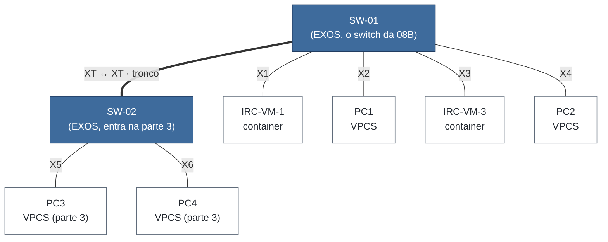
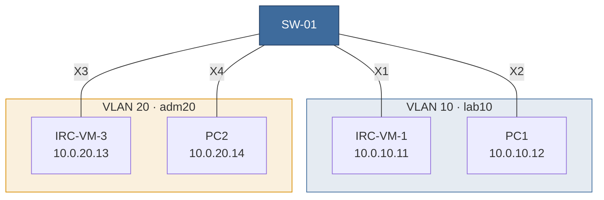
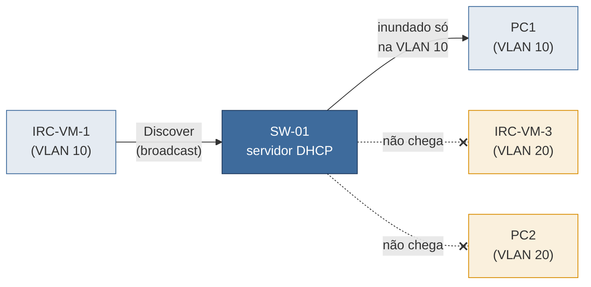
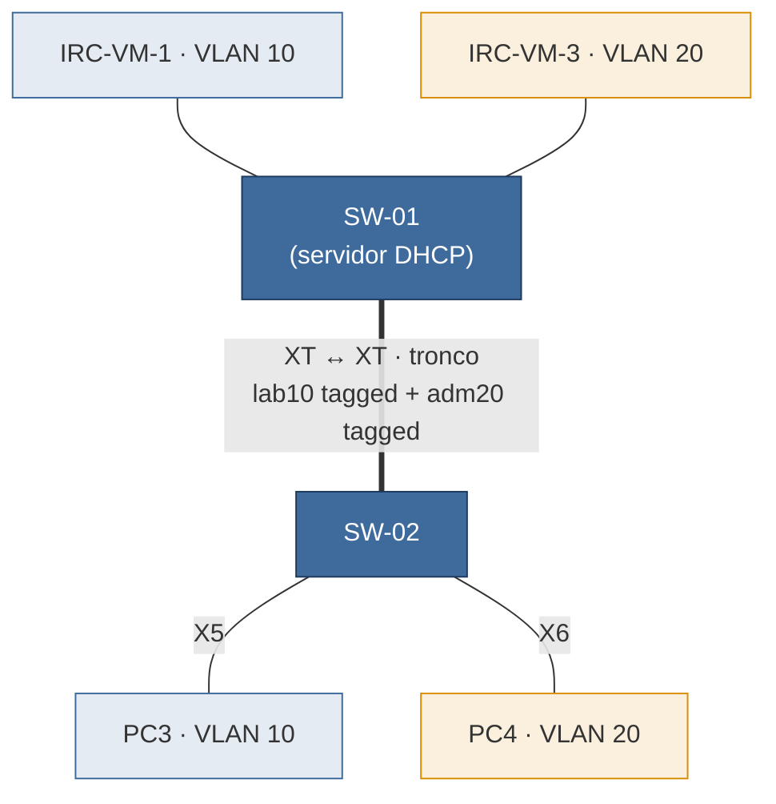
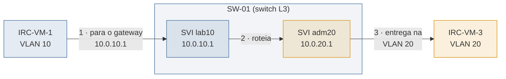
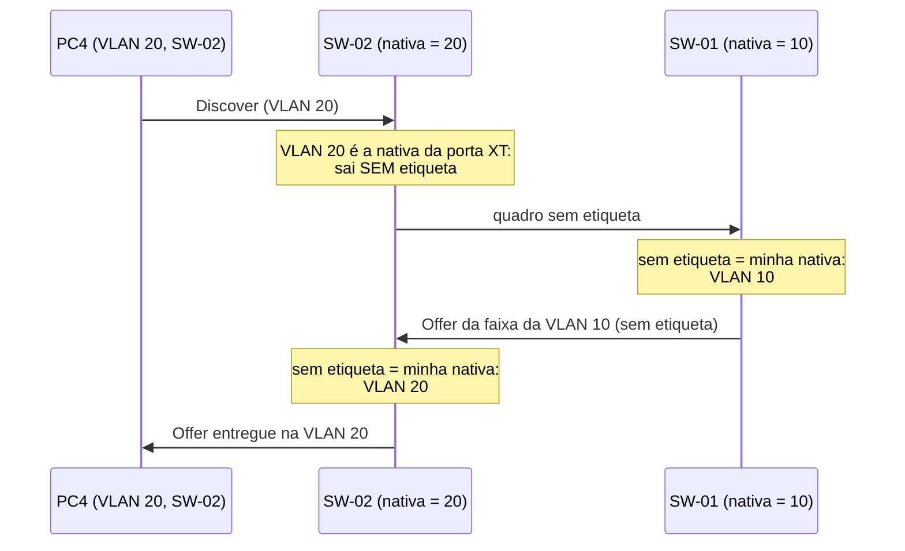

# Guia prático da Aula 09: VLAN, DHCP por VLAN, tronco e roteamento


Este guia reproduz, aproximadamente, as demonstrações da aula 09 (*Virtual Local Area Network, 802.1Q*). Ele segue a mesma ordem da aula: cada parte corresponde a um momento em que o professor parou os slides para mostrar no GNS3. 

| Parte | O que você vai fazer | Na aula, depois de |
|---|---|---|
| [Preparação](#preparação) | Adaptar o cenário da aula 08B | — |
| [1. VLANs em um switch](#1-vlans-em-um-switch) | Separar laboratório e secretaria em dois domínios de broadcast | Seção 3 (IEEE 802.1Q) |
| [2. DHCP por VLAN](#2-dhcp-por-vlan) | Uma faixa de endereços para cada VLAN | Seção 4 (DHCP por VLAN) |
| [3. Tronco entre switches](#3-tronco-entre-switches) | Ligar um segundo switch e levar as duas VLANs até ele | Seção 5 (portas access e trunk) |
| [4. Roteamento entre VLANs](#4-roteamento-entre-vlans) | Fazer as VLANs conversarem pela camada 3 | Seção 6 (roteamento entre VLANs) |
| [5. Desafio: VLAN nativa](#5-desafio-vlan-nativa) | Provocar (e detectar) um vazamento entre VLANs | Seção 5 (VLAN nativa) |

> **Dica:** antes de cada parte, tire um *snapshot* no GNS3 (*Edit → Manage snapshots*). Se algo der errado, você volta ao início da parte em vez de recomeçar tudo.

---

## Preparação

Você vai partir do projeto do `9-vlan`, em [`../cenarios/`](../cenarios/), lembrar de substituir dois containers por PCs simples e, na parte 3.



- **SW-01** é o switch da aula 08B. É nele que fica quase tudo: as VLANs, o servidor DHCP e o roteamento.
- **SW-02** entra só na parte 3, ligado ao SW-01 por um tronco.
- **IRC-VM-1** e **IRC-VM-3** são os containers Linux da 08B (imagem `irc-lab`). Eles ficam porque têm `tcpdump`: é com eles que você vai escutar a rede.
- **PC1 a PC4** são **VPCS**, um simulador de PC bem simples do GNS3: configura IP, pede DHCP e faz `ping` e `trace`.

### Plano de endereçamento

Os nomes e endereços são os mesmos dos slides:

| VLAN | Nome | VID | Sub-rede | Gateway (IP do switch) | Faixa DHCP |
|---|---|---|---|---|---|
| Laboratório | `lab10` | 10 | `10.0.10.0/24` | `10.0.10.1` | `10.0.10.100` a `.199` |
| Administrativo | `adm20` | 20 | `10.0.20.0/24` | `10.0.20.1` | `10.0.20.100` a `.199` |

| Host | Switch / porta | VLAN | Papel nos slides | IP fixo (parte 1) |
|---|---|---|---|---|
| IRC-VM-1 | SW-01 / X1 | `lab10` | PC do laboratório A | `10.0.10.11/24` |
| PC1 | SW-01 / X2 | `lab10` | PC do laboratório B | `10.0.10.12/24` |
| IRC-VM-3 | SW-01 / X3 | `adm20` | Estação da secretaria | `10.0.20.13/24` |
| PC2 | SW-01 / X4 | `adm20` | Servidor financeiro | `10.0.20.14/24` |
| PC3 | SW-02 / X5 | `lab10` | — | DHCP (parte 3) |
| PC4 | SW-02 / X6 | `adm20` | — | DHCP (parte 3) |

No GNS3, a interface `PortN` do EXOS-VM corresponde à porta N do switch. A interface `Mgmt` não é usada neste guia.

### Adaptando o projeto da 08B

1. Importe o projeto
2. Apague a **IRC-VM-2** e a **IRC-VM-4** (selecione e tecle *Delete*).
3. Renomeie o switch para **SW-01** (botão direito → *Change hostname*).
4. No painel de dispositivos, em *End devices*, arraste dois **VPCS** e renomeie-os para **PC1** e **PC2**.
5. Ligue o PC1 à porta X2 e o PC2 à porta X4 do SW-01. A IRC-VM-1 e a IRC-VM-3 já vêm ligadas ao switch: passe o mouse sobre o cabo e confira se estão nas portas X1 e X3. Se não estiverem, apague o cabo e ligue de novo.

### Acessando os equipamentos

1. Inicie todos os nós (▶ verde). O EXOS leva alguns minutos para subir; espere aparecer o prompt de login.
2. Clique duas vezes num nó para abrir o console.
3. No **EXOS**, o usuário é `admin` e a senha é vazia (só tecle Enter).
4. Nos **containers**, o console abre direto num shell, como `root`. Os comandos marcados com `IRC-VM-1#` rodam ali.
5. No **VPCS**, o prompt é o nome do PC (`PC1>`).

### Ponto de partida: tudo na VLAN `Default`

Num EXOS de fábrica, **todas as portas estão untagged na VLAN `Default`** (VID 1): um único domínio de broadcast, exatamente a situação da aula 08B. Confira no SW-01:

```
show vlan
```

**O que procurar:** a VLAN `Default`, com tag 1 e todas as portas, e nenhuma VLAN criada por você. A VLAN `Mgmt` é a da porta de gerência e não entra neste guia.

Se aparecer alguma configuração da 08B (um IP na `Default`, por exemplo), volte o switch ao padrão de fábrica com `unconfigure switch all`. Ele pede confirmação e reinicia.


---

## 1. VLANs em um switch

**Objetivo:** separar o laboratório (IRC-VM-1 e PC1) da secretaria (IRC-VM-3 e PC2) em dois domínios de broadcast, sem trocar nenhum cabo.

Esta parte começa pelo "ataque hipotético" da motivação da aula: um aluno no laboratório captura o tráfego e vê o broadcast da secretaria. Primeiro você vai ver o problema acontecer; depois, vai resolvê-lo com VLANs.



### 1.1 Dar endereços fixos aos hosts

Nesta parte ainda não há DHCP: os endereços são configurados à mão. Os containers vêm da 08B com endereços `10.0.0.x`; troque-os pelos da tabela.

```
IRC-VM-1# ip addr flush dev eth0
IRC-VM-1# ip addr add 10.0.10.11/24 dev eth0
IRC-VM-1# ip route replace default via 10.0.10.1
```

```
IRC-VM-3# ip addr flush dev eth0
IRC-VM-3# ip addr add 10.0.20.13/24 dev eth0
IRC-VM-3# ip route replace default via 10.0.20.1
```

```
PC1> ip 10.0.10.12/24 10.0.10.1
PC2> ip 10.0.20.14/24 10.0.20.1
```

No VPCS, o formato é `ip <endereço>/<prefixo> <gateway>`. Os gateways ainda não existem, mas já ficam configurados para a parte 4.

Repare: laboratório e secretaria já estão em **sub-redes diferentes**. Isso basta para separá-los?

### 1.2 Ver o problema: o laboratório escuta a secretaria

Na IRC-VM-1 (o aluno do laboratório), comece a escutar os pedidos de ARP:

```
IRC-VM-1# tcpdump -ni eth0 -e arp
```

Na IRC-VM-3 (a secretaria), apague o cache ARP e fale com o PC2:

```
IRC-VM-3# ip neigh flush all
IRC-VM-3# ping -c 2 10.0.20.14
```

**O que procurar:** na tela da IRC-VM-1 aparece o pedido ARP da secretaria (`Request who-has 10.0.20.14 tell 10.0.20.13`), com destino `ff:ff:ff:ff:ff:ff`. A IRC-VM-1 está em outra sub-rede e mesmo assim recebe o quadro. **Sub-rede diferente não separa o domínio de broadcast:** quem decide até onde o broadcast vai é o switch, e para ele ainda existe uma rede só.

Deixe o `tcpdump` rodando, porque você vai repetir o teste depois de criar as VLANs.

### 1.3 Criar as VLANs e mover as portas (SW-01)

Os comandos são os do slide *A tabela por trás da configuração*:

```
create vlan lab10 tag 10
create vlan adm20 tag 20
configure vlan Default delete ports X1,X2,X3,X4
configure vlan lab10 add ports X1,X2
configure vlan adm20 add ports X3,X4
```

Por que a linha do `delete`? Toda porta nasce untagged na `Default`, e uma porta só pode ser untagged em **uma** VLAN. Se você tentar pôr a porta X1 em `lab10` sem tirá-la da `Default` antes, o EXOS recusa com um erro de conflito.

Sem `tagged` nem `untagged` no fim do comando, a porta entra como **untagged**, que é o que se quer para um host: uma porta access.

<!-- PROFESSOR: confirmar na EXOS-VM que "add ports" sem tagged/untagged entra como untagged (pendência já anotada em 2-conceito.tex) -->

Confira:

```
show vlan
show vlan lab10
show vlan adm20
```

**O que procurar:** as portas X1 e X2 em `lab10` e as portas X3 e X4 em `adm20`, todas untagged. Nenhuma delas aparece mais na `Default`.

<!-- PROFESSOR: colar aqui a saída real de "show vlan" -->

### 1.4 Testar

Repita a conversa da secretaria (a IRC-VM-1 continua com o `tcpdump` aberto):

```
IRC-VM-3# ip neigh flush all
IRC-VM-3# ping -c 2 10.0.20.14
```

Depois, pare o `tcpdump` (`Ctrl+C`) e teste a partir da IRC-VM-1:

```
IRC-VM-1# ping -c 3 10.0.10.12     # PC1, mesma VLAN
IRC-VM-1# ping -c 3 10.0.20.13     # IRC-VM-3, outra VLAN
```

**Resultado esperado:**
- A secretaria continua falando com o PC2 (mesma VLAN), mas o pedido ARP **não aparece mais** na IRC-VM-1. O aluno do laboratório deixou de ouvir a secretaria.
- IRC-VM-1 → PC1: **responde.** Mesma VLAN, mesmo domínio de broadcast.
- IRC-VM-1 → IRC-VM-3: **não responde.** Outra VLAN, e ainda não há quem roteie entre elas.

### Para pensar

O ping para a IRC-VM-3 falhou por causa da VLAN ou porque ela está em outra sub-rede? Faça o teste: coloque a IRC-VM-3, por um momento, na sub-rede do laboratório, sem mexer no cabo (ela continua numa porta da VLAN 20), e pingue de novo.

```
IRC-VM-3# ip addr flush dev eth0
IRC-VM-3# ip addr add 10.0.10.13/24 dev eth0
```

```
IRC-VM-1# ping -c 3 10.0.10.13
```

<details>
<summary>Resposta</summary>

O ping continua falhando. Para falar com `10.0.10.13`, a IRC-VM-1 primeiro pergunta o MAC dele por ARP, que é broadcast, e o switch só entrega esse broadcast às portas da VLAN 10. A IRC-VM-3 nunca ouve a pergunta, então nunca responde. **A VLAN isola em camada 2, seja qual for o IP do host.** Se quiser ver, deixe um `tcpdump -ni eth0 arp` na IRC-VM-3 durante o teste: nada chega.

</details>

Antes de seguir, devolva o endereço original da IRC-VM-3:

```
IRC-VM-3# ip addr flush dev eth0
IRC-VM-3# ip addr add 10.0.20.13/24 dev eth0
IRC-VM-3# ip route replace default via 10.0.20.1
```

### Não funcionou? Confira

- Erro ao adicionar a porta na VLAN → faltou o `configure vlan Default delete ports ...`.
- O ping dentro da mesma VLAN falha → as duas portas estão mesmo na mesma VLAN (`show vlan lab10`)? O cabo está na porta certa?
- O pedido ARP continua aparecendo na IRC-VM-1 → a porta X1 ou a X3 ficou na `Default` (`show vlan Default`).
- O `ping` do container responde *Network is unreachable* → faltou o `ip addr add` ou o `ip route replace` do passo 1.1. Se você reiniciou o container, os endereços voltaram aos da 08B (`10.0.0.x`): refaça o passo 1.1.

---

## 2. DHCP por VLAN

**Objetivo:** fazer o SW-01 entregar endereços, com uma faixa diferente para cada VLAN.

Na aula 08B, o servidor DHCP do switch atendia a rede inteira (a VLAN `Default`), e o Discover de um host chegava a todas as portas. Agora existem dois domínios de broadcast, e o Discover **não sai da VLAN** de quem pediu. Por isso cada VLAN precisa de um servidor que a escute e de uma faixa própria: um **escopo** por VLAN.



### 2.1 Os três passos, para cada VLAN (SW-01)

Como na 08B, o servidor DHCP do EXOS exige três passos, e **nenhum é opcional**:

1. **Dar um IP ao switch na VLAN.** Esse IP é o endereço do servidor e será também o gateway dos hosts. Nos slides, ele é a SVI da seção 6.
2. **Configurar o serviço:** a faixa de endereços e o gateway que serão entregues.
3. **Habilitar o serviço nas portas** que vão ser atendidas.

**VLAN `lab10`** (portas X1 e X2):

```
configure vlan lab10 ipaddress 10.0.10.1/24
configure vlan lab10 dhcp-address-range 10.0.10.100 - 10.0.10.199
configure vlan lab10 dhcp-options default-gateway 10.0.10.1
enable dhcp ports X1,X2 vlan lab10
```

**VLAN `adm20`** (portas X3 e X4):

```
configure vlan adm20 ipaddress 10.0.20.1/24
configure vlan adm20 dhcp-address-range 10.0.20.100 - 10.0.20.199
configure vlan adm20 dhcp-options default-gateway 10.0.20.1
enable dhcp ports X3,X4 vlan adm20
```

Confira a configuração de cada VLAN:

```
show vlan lab10 dhcp-config
show vlan adm20 dhcp-config
```

**O que procurar:** a faixa, o gateway e as portas em que o DHCP está habilitado, em cada VLAN.

<!-- PROFESSOR: confirmar na EXOS-VM que o servidor atende as duas VLANs ao mesmo tempo, cada uma com sua faixa -->

<!-- PROFESSOR: colar aqui a saída real de "show vlan lab10 dhcp-config" -->

### 2.2 O Discover não sai da VLAN

Antes de pedir endereço, deixe a **secretaria** escutando o DHCP:

```
IRC-VM-3# tcpdump -ni eth0 -e port 67 or port 68
```

Agora a IRC-VM-1 troca o IP fixo por DHCP:

```
IRC-VM-1# ip addr flush dev eth0
IRC-VM-1# dhclient -v eth0
IRC-VM-1# ip addr show eth0
IRC-VM-1# ip route
```

**Resultado esperado:**
- A IRC-VM-1 recebe um endereço `10.0.10.1xx`, com rota padrão via `10.0.10.1`. A saída do `dhclient -v` mostra a troca completa: DHCPDISCOVER, DHCPOFFER, DHCPREQUEST e DHCPACK.
- Na IRC-VM-3, **nada aparece**. Na aula 08B, o Discover de um host aparecia na captura de outro; agora ele fica dentro da VLAN 10.

<!-- PROFESSOR: confirmar o cliente DHCP da imagem irc-lab (dhclient ou udhcpc), mesma pendência da 08B -->

Pare o `tcpdump` (`Ctrl+C`) e peça endereço nos demais hosts:

```
IRC-VM-3# ip addr flush dev eth0
IRC-VM-3# dhclient -v eth0
```

```
PC1> ip dhcp
PC2> ip dhcp
```

Confira no VPCS com `show ip`.

**Resultado esperado:** IRC-VM-1 e PC1 recebem `10.0.10.1xx`, com gateway `10.0.10.1`; IRC-VM-3 e PC2 recebem `10.0.20.1xx`, com gateway `10.0.20.1`. O servidor escolhe a faixa pela VLAN em que o pedido chegou.

Anote os endereços recebidos, porque você vai usá-los até o fim do guia:

| Host | IP recebido |
|---|---|
| IRC-VM-1 | |
| PC1 | |
| IRC-VM-3 | |
| PC2 | |

### 2.3 As VLANs continuam isoladas

```
IRC-VM-1# ping -c 3 10.0.10.1             # o switch, na própria VLAN
IRC-VM-1# ping -c 3 <IP do PC1>           # mesma VLAN
IRC-VM-1# ping -c 3 <IP da IRC-VM-3>      # outra VLAN
```

**Resultado esperado:** os dois primeiros respondem; a IRC-VM-3, **não**.

### Para pensar

1. A IRC-VM-3 não viu o Discover da IRC-VM-1. Na aula 08B, a IRC-VM-2 viu o da IRC-VM-1. O que mudou?
2. O switch agora tem um IP em cada VLAN. Por que a IRC-VM-1 ainda não alcança a IRC-VM-3?
3. O que aconteceria se você esquecesse o passo 3 (`enable dhcp ports`) na VLAN `adm20`?

<details>
<summary>Respostas</summary>

1. O tamanho do domínio de broadcast. Na 08B, o switch inteiro era um domínio só. Agora o domínio é a VLAN, e o Discover é inundado apenas nas portas da VLAN 10.
2. Ter um IP em cada VLAN não faz o switch **rotear** entre elas. No EXOS, o encaminhamento entre sub-redes precisa ser ligado à parte, com `enable ipforwarding`, o que você fará na parte 4.
3. A IRC-VM-3 e o PC2 ficariam sem endereço. O serviço existe, mas o switch só responde ao Discover que chega por uma porta habilitada. Nas demais, o Discover é tratado como um broadcast qualquer, e ninguém responde.

</details>

### Não funcionou? Confira

- O host não recebe endereço → a porta dele está na lista do `enable dhcp ports` **daquela VLAN**? É o esquecimento mais comum.
- O host recebe endereço da faixa errada → a porta está na VLAN errada (`show vlan`).
- A faixa precisa estar dentro da sub-rede do IP do passo 1 e não pode incluir o próprio `.1`.
- `dhclient: command not found` → tente `udhcpc -i eth0`.

---

## 3. Tronco entre switches

**Objetivo:** ligar um segundo switch e levar as duas VLANs até ele por **um único cabo**.

Esse cabo vai carregar quadros das duas VLANs ao mesmo tempo. Para o switch do outro lado saber a qual VLAN cada quadro pertence, eles viajam **etiquetados (802.1Q)**: é a etiqueta da seção 3 da aula. No EXOS, uma porta assim é **tagged** nas VLANs que carrega; no mercado, ela é chamada de **trunk**.



(O PC1 e o PC2 continuam ligados ao SW-01; foram omitidos do desenho.)

### 3.1 Acrescentar o SW-02, o PC3 e o PC4

No GNS3:

1. Arraste um novo **EXOS-VM** (o mesmo modelo do SW-01) e renomeie-o para **SW-02**.
2. Arraste dois **VPCS** e renomeie-os para **PC3** e **PC4**.
3. Ligue os cabos:
   - SW-01, porta XT ↔ SW-02, porta XT;
   - PC3 → SW-02, porta X5;
   - PC4 → SW-02, porta X6.
4. Inicie os nós novos e espere o SW-02 subir (usuário `admin`, senha vazia).

### 3.2 Criar as mesmas VLANs no SW-02

```
create vlan lab10 tag 10
create vlan adm20 tag 20
configure vlan Default delete ports X5,X6
configure vlan lab10 add ports X5
configure vlan adm20 add ports X6
```

O que identifica a VLAN entre os switches é o **VID** (10, 20), que viaja na etiqueta, e não o nome. Manter os mesmos nomes nos dois lados só facilita a leitura.

### 3.3 Configurar o tronco (nos dois switches)

Execute **no SW-01 e no SW-02**. É o bloco *Só etiquetadas (recomendado)* do slide *Tronco no EXOS*, com a porta XT no lugar da porta 24:

```
configure vlan Default delete ports XT
configure vlan lab10 add ports XT tagged
configure vlan adm20 add ports XT tagged
```

Tiramos a porta XT da `Default` de propósito: assim **todo** quadro do tronco viaja etiquetado e não sobra VLAN nativa. Se a porta continuasse na `Default`, a VLAN 1 seria a nativa do tronco, o caso que os slides mandam evitar (e que a parte 5 explora).

Confira em cada switch:

```
show vlan lab10
show vlan adm20
```

**O que procurar:** a porta XT aparece nas duas VLANs, marcada como **tagged**. As portas dos hosts continuam untagged.

<!-- PROFESSOR: colar aqui a saída real mostrando a porta XT tagged -->

### 3.4 Pedir endereço no PC3 e no PC4

```
PC3> ip dhcp
PC4> ip dhcp
```

O servidor DHCP está no SW-01, e o Discover do PC3 chega lá pelo tronco. Mesmo assim, **o PC3 provavelmente vai ficar sem endereço.** Antes de abrir a resposta, tente descobrir por quê.

<details>
<summary>Por que não funcionou?</summary>

Na parte 2, o DHCP foi habilitado só nas portas X1 a X4 do SW-01. O Discover do PC3 entra no SW-01 pela **porta XT**, onde o serviço não está habilitado. É o passo 3 de novo: o serviço existe, mas não atende aquela porta. No **SW-01**:

```
enable dhcp ports XT vlan lab10
enable dhcp ports XT vlan adm20
```

Peça o endereço outra vez (`ip dhcp`). Agora o PC3 recebe `10.0.10.1xx` e o PC4 recebe `10.0.20.1xx`: cada um ganha a faixa da sua VLAN, mesmo estando em outro switch.

</details>

<!-- PROFESSOR: confirmar na EXOS-VM que o DHCP só responde pela porta XT depois do "enable dhcp ports XT" -->

### 3.5 Testar através do tronco

```
PC3> ping <IP da IRC-VM-1>
PC3> ping <IP da IRC-VM-3>
```

**Resultado esperado:** PC3 → IRC-VM-1 **responde** (mesma VLAN, switches diferentes). PC3 → IRC-VM-3 **não responde** (VLANs diferentes, ainda sem roteamento).

### 3.6 Ver a etiqueta no Wireshark

No GNS3, clique com o botão direito no cabo **SW-01 ↔ SW-02** e escolha *Start capture*. Faça o mesmo no cabo do **PC3**. Repita o ping PC3 → IRC-VM-1 e, depois, faça um ping PC4 → IRC-VM-3 (que também está na VLAN 20). Filtre as duas capturas por `icmp`.

**O que procurar no tronco:**
- no cabeçalho Ethernet, o campo *Type* vale `0x8100`: é o **TPID**, avisando que há uma etiqueta;
- logo depois, a camada **802.1Q Virtual LAN**, com os campos da TCI: `PRI` (o PCP), `DEI` e `ID` (o **VID**). O `ID` vale 10 nos quadros do primeiro ping e 20 nos do segundo;
- o mesmo ping fica **4 bytes maior** no tronco do que no cabo do PC3 (compare o *Frame length*). São os 4 bytes da etiqueta, o motivo de o quadro máximo passar de 1518 para 1522 bytes.

**O que procurar no cabo do PC3:** os mesmos quadros, **sem** a camada 802.1Q. A porta access retira a etiqueta antes de entregar o quadro ao host.

### 3.7 A tabela MAC é por VLAN

No SW-01:

```
show fdb
```

**O que procurar:** a VLAN de cada entrada. Os MACs do PC3 e do PC4 aparecem na **mesma porta (XT)**, mas em VLANs diferentes (`lab10` e `adm20`). É a tabela do slide *Etiquetar ou não*: o MAC de destino escolhe a porta, e o par (porta, VLAN) decide se o quadro sai etiquetado.

<!-- PROFESSOR: colar aqui a saída real de "show fdb" do SW-01 com os MACs do PC3 e do PC4 na porta XT -->

### Para pensar

1. Quantos cabos seriam necessários entre os dois switches se não existisse a etiqueta 802.1Q?
2. Se você criasse uma VLAN 30 no SW-02 e esquecesse de adicioná-la à porta XT, o que aconteceria com os hosts dela?

<details>
<summary>Respostas</summary>

1. Um por VLAN: cada cabo ligaria uma porta access da VLAN 10 (ou 20) de um switch à do outro. Com duas VLANs, dá para fazer; com cinquenta, não.
2. Eles se falariam dentro do SW-02, mas nada da VLAN 30 atravessaria o tronco. Uma VLAN só existe nos lugares para onde ela foi explicitamente levada.

</details>

### Não funcionou? Confira

- O ping entre PC3 e IRC-VM-1 falha → a porta XT está **tagged** nas duas VLANs **nos dois switches**? Os VIDs batem (10 e 20 dos dois lados)?
- O PC3 continua sem endereço depois do `enable dhcp ports XT` → no SW-02, a porta X5 está em `lab10` (`show vlan lab10`)?
- O Wireshark não mostra a camada 802.1Q → você está capturando no cabo de um host, e não no tronco.

---

## 4. Roteamento entre VLANs

**Objetivo:** fazer as VLANs se comunicarem, usando o SW-01 como roteador (switch L3).

O SW-01 tem um IP em cada VLAN desde a parte 2. Essas interfaces de camada 3 são as **SVIs** (*switch virtual interfaces*) da seção 6, e são os gateways dos hosts. Falta só mandar o switch **encaminhar** pacotes entre elas.



### 4.1 Habilitar o encaminhamento (SW-01)

São as duas linhas do slide *SVI no EXOS* que ainda faltavam:

```
enable ipforwarding vlan lab10
enable ipforwarding vlan adm20
```

Confira:

```
show ipconfig
```

**O que procurar:** as duas VLANs com seus IPs e o encaminhamento (*forwarding*) habilitado.

<!-- PROFESSOR: colar aqui a saída real de "show ipconfig" -->

### 4.2 Testar

```
IRC-VM-1# ping -c 3 <IP da IRC-VM-3>
```

```
PC1> trace <IP da IRC-VM-3>
PC3> ping <IP do PC4>
```

**Resultado esperado:**
- Todos respondem.
- O `trace` mostra **um salto intermediário**, `10.0.10.1`: a SVI da VLAN 10 no SW-01.
- No `ping` da IRC-VM-1, as respostas chegam com `ttl=63`. A IRC-VM-3 (Linux) envia com TTL 64, e o roteador desconta 1.

### 4.3 O pacote troca de quadro, não de endereço IP

É o slide *O caminho de um pacote entre VLANs*. No GNS3, inicie uma captura no cabo da **IRC-VM-1** e outra no cabo da **IRC-VM-3**. Depois:

```
IRC-VM-1# ping -c 1 <IP da IRC-VM-3>
```

**O que procurar:** compare o mesmo *echo request* nas duas capturas.

| Campo | Cabo da IRC-VM-1 (VLAN 10) | Cabo da IRC-VM-3 (VLAN 20) |
|---|---|---|
| MAC de origem | IRC-VM-1 | SW-01 |
| MAC de destino | SW-01 (o gateway) | IRC-VM-3 |
| IP de origem e de destino | IRC-VM-1 → IRC-VM-3 | os mesmos |
| TTL | 64 | 63 |

O roteador monta um **novo cabeçalho de camada 2** para a VLAN de saída e decrementa o TTL, mas os endereços IP não mudam. Para saber qual MAC é de quem, use `ip link show eth0` nos containers e `show iparp` no SW-01.

### Para pensar

O PC3 e o PC4 estão **no mesmo switch** (SW-02), mas em VLANs diferentes. Que caminho faz o ping entre eles?

<details>
<summary>Resposta</summary>

O SW-02 não roteia: só o SW-01 tem as SVIs com encaminhamento ligado. O pacote do PC3 sobe pelo tronco na VLAN 10 até o gateway `10.0.10.1`, no SW-01, é roteado para a VLAN 20 e **volta pelo mesmo tronco**, agora etiquetado com VID 20, até o PC4. É o desenho do *router-on-a-stick* da seção 6, com o SW-01 no papel do roteador. Você pode confirmar capturando no tronco: o mesmo ping aparece duas vezes, uma com `ID: 10` e outra com `ID: 20`. É também o limite apontado no slide: todo o tráfego entre VLANs cruza o enlace duas vezes.

</details>

### Não funcionou? Confira

- O ping entre VLANs falha, mas o ping ao gateway funciona → faltou o `enable ipforwarding` em **uma** das VLANs.
- O host não tem gateway → no VPCS, `show ip`; no container, `ip route`. Se o gateway estiver vazio, peça o endereço de novo (`ip dhcp` no VPCS, `dhclient -v eth0` no container).

---

## 5. Desafio: VLAN nativa

**Objetivo:** ver, na prática, por que os slides insistem em cuidar da VLAN nativa, e como o LLDP denuncia o problema.

Num tronco, a **VLAN nativa** é aquela cujos quadros viajam **sem etiqueta**. Quem recebe um quadro sem etiqueta o coloca na **sua** VLAN nativa. A VLAN de um quadro sem etiqueta não viaja com ele: a nativa é configuração local de cada ponta. Se as duas pontas discordarem, os quadros mudam de VLAN no meio do caminho, sem erro e sem alarme.

Vamos montar o cenário do slide *Por que o switch não percebe nativas diferentes*: no SW-01, a nativa da porta XT será a VLAN 10; no SW-02, a VLAN 20.



### 5.1 Tornar as nativas diferentes

**No SW-01** (a VLAN 10 passa a ir sem etiqueta na porta XT):

```
configure vlan lab10 delete ports XT
configure vlan lab10 add ports XT untagged
```

**No SW-02** (a VLAN 20 passa a ir sem etiqueta na porta XT):

```
configure vlan adm20 delete ports XT
configure vlan adm20 add ports XT untagged
```

Agora cada ponta tem uma VLAN untagged no tronco, ou seja, uma nativa, e as duas discordam.

### 5.2 Observar o vazamento

No PC4 (VLAN 20, no SW-02), peça um endereço de novo:

```
PC4> ip dhcp
PC4> show ip
```

**O que observar:** o PC4, que está na VLAN 20, recebe um endereço **da faixa da VLAN 10** (`10.0.10.1xx`). O Discover dele saiu do SW-02 sem etiqueta, entrou no SW-01 como se fosse da VLAN 10 e foi respondido pelo escopo da VLAN 10.

Agora o PC4 alcança a IRC-VM-1 diretamente, em camada 2:

```
PC4> ping <IP da IRC-VM-1>
```

Para ter certeza de que não é o roteamento da parte 4, desligue-o no SW-01 e repita o ping. Ele continua respondendo:

```
disable ipforwarding vlan lab10
disable ipforwarding vlan adm20
```

### 5.3 Detectar com o LLDP

O quadro não carrega a nativa, então nenhum dos switches percebe o erro sozinho. A pista vem do LLDP, visto na aula 08B: um TLV opcional anuncia o PVID da porta, que é a VLAN nativa dela. Ligue o anúncio **nos dois switches**:

```
enable lldp ports XT
configure lldp ports XT advertise vendor-specific dot1 port-vlan-ID
```

Espere uns 30 s (o intervalo do LLDP) e veja o que cada switch ouviu do vizinho:

```
show lldp neighbors detailed
```

**O que procurar:** no SW-01, o vizinho da porta XT (o SW-02) anuncia **PVID 20**; no SW-02, o SW-01 anuncia **PVID 10**. Comparando o anúncio do vizinho com a própria configuração, a diferença aparece.

<!-- PROFESSOR: confirmar na EXOS-VM o comando de anúncio do PVID e onde o valor aparece em "show lldp neighbors detailed" (pendência de 4-acesso.tex); colar a saída real -->

### Para pensar

1. Algum dos switches registrou erro? Algum contador de descarte subiu?
2. Que configuração da parte 3 evita esse problema?

<details>
<summary>Respostas</summary>

1. Não. Os dois switches receberam quadros Ethernet perfeitamente válidos e fizeram exatamente o que a configuração mandava. É por isso que o problema é perigoso: **nada falha**, duas VLANs simplesmente viram uma só.
2. O tronco só com etiquetas, sem VLAN nativa: tirar a porta da `Default` e adicioná-la como **tagged** em todas as VLANs, nas duas pontas. Com a etiqueta, o VID viaja dentro do quadro. Se a VLAN não existir no tronco do vizinho, o quadro é descartado, em vez de mudar de VLAN.

</details>

### 5.4 Desfazer

Volte o tronco ao estado recomendado da parte 3, nos dois switches.

**No SW-01:**

```
configure vlan lab10 delete ports XT
configure vlan lab10 add ports XT tagged
enable ipforwarding vlan lab10
enable ipforwarding vlan adm20
```

**No SW-02:**

```
configure vlan adm20 delete ports XT
configure vlan adm20 add ports XT tagged
```

Depois, rode `ip dhcp` de novo no PC4: ele deve voltar a receber `10.0.20.1xx`.

Para guardar o estado final, rode `save configuration` nos dois switches e `save` nos VPCS, e salve o projeto no GNS3.

---

## Resumo dos comandos

| Para… | Comando (EXOS) |
|---|---|
| Criar uma VLAN | `create vlan <nome> tag <VID>` |
| Tirar portas da VLAN padrão | `configure vlan Default delete ports <portas>` |
| Porta access | `configure vlan <nome> add ports <portas>` (ou `... untagged`) |
| Porta de tronco | `configure vlan <nome> add ports <portas> tagged` (uma vez por VLAN) |
| IP do switch na VLAN (SVI) | `configure vlan <nome> ipaddress <ip>/<prefixo>` |
| Faixa DHCP | `configure vlan <nome> dhcp-address-range <ip1> - <ip2>` |
| Gateway entregue pelo DHCP | `configure vlan <nome> dhcp-options default-gateway <ip>` |
| Ligar o DHCP nas portas | `enable dhcp ports <portas> vlan <nome>` |
| Ver o DHCP da VLAN | `show vlan <nome> dhcp-config` |
| Rotear entre VLANs | `enable ipforwarding vlan <nome>` |
| Ver a tabela MAC | `show fdb` |
| Anunciar a VLAN nativa no LLDP | `configure lldp ports <portas> advertise vendor-specific dot1 port-vlan-ID` |
| Ver os vizinhos LLDP | `show lldp neighbors detailed` |
| Conferir | `show vlan`, `show vlan <nome>`, `show ipconfig`, `show iparp` |
| Voltar ao padrão de fábrica | `unconfigure switch all` |
| Salvar a configuração | `save configuration` |

| Para… | Comando (containers Linux) |
|---|---|
| Apagar o endereço da interface | `ip addr flush dev eth0` |
| IP fixo | `ip addr add <ip>/<prefixo> dev eth0` |
| Gateway | `ip route replace default via <ip>` |
| IP por DHCP | `dhclient -v eth0` |
| Ver endereço e rotas | `ip addr show eth0`, `ip route` |
| Limpar o cache ARP | `ip neigh flush all` |
| Escutar a interface | `tcpdump -ni eth0 -e <filtro>` |
| Testar | `ping -c 3 <ip>` |

| Para… | Comando (VPCS) |
|---|---|
| IP fixo | `ip <ip>/<prefixo> <gateway>` |
| IP por DHCP | `ip dhcp` |
| Ver a configuração | `show ip` |
| Testar | `ping <ip>`, `trace <ip>` |
| Salvar | `save` |
