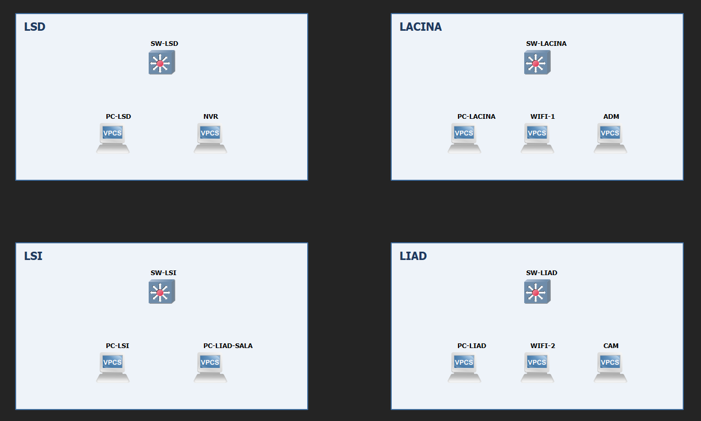

# Atividade a rede da UASC

Vocês fazem parte da equipe de redes do STI da UFCG. A UASC vai ganhar uma rede nova, compartilhada por quatro laboratórios: **LSD**, **LACINA**, **LSI** e **LIAD**. Cada laboratório tem um switch próprio, e a rede precisa atender, além dos computadores dos laboratórios, o Wi-Fi, as câmeras de segurança e a administração dos switches. A chefia passou essa implantação para a equipe de vocês.

> **Ordem de serviço 0713**
>
> - **Solicitante:** STI/UFCG
> - **Cliente:** Unidade Acadêmica de Sistemas e Computação (UASC): laboratórios LSD, LACINA, LSI e LIAD
> - **Responsável:** a equipe de vocês
> - **Escopo:** projetar a rede da UASC, implantá-la em bancada, passar nos testes de aceite, atender os pedidos de mudança e entregar a documentação
> - **Entregáveis e prazo:** ver [Entrega](#entrega)

O STI fez o levantamento: quais redes existem, o que cada uma exige e onde fica cada equipamento. Isso está em [Levantamento do STI](#levantamento-do-sti). O resto é com a equipe: o endereçamento, como ligar os switches, qual deles roteia, as portas e o DHCP.

O trabalho segue as etapas de qualquer implantação no STI:

1. [Projeto](#etapa-1-projeto) : Planeja o endereçamento e decide como ligar e configurar os quatro switches
2. [Implantação em bancada](#etapa-2-implantação-em-bancada) : Monta e configura a rede no GNS3, a bancada de testes do STI
3. [Testes de aceite](#etapa-3-testes-de-aceite) : Prova que a rede funciona. Só depois disso o STI recebe a rede
4. [Pedidos de mudança](#etapa-4-pedidos-de-mudança) : Atende três chamados que chegam depois que a rede entra em operação
5. [Documentação](#etapa-5-documentação) : Entrega ao STI a descrição da rede como ela ficou, e responde à revisão técnica

A última seção, [Avaliação e entrega](#avaliação-e-entrega), explica como a atividade é avaliada na disciplina.

## Levantamento do STI

O STI visitou os quatro laboratórios e levantou o que a rede precisa atender. A equipe projeta a partir destes requisitos.

### As redes

| Rede      | O que tem nela                                                        | Hosts | Gateway        | Endereço dos hosts |
| --------- | --------------------------------------------------------------------- | ----: | -------------- | ------------------- |
| LSD       | Estações e computadores do LSD                                      |    70 | sim            | DHCP                |
| LACINA    | Estações e computadores do LACINA                                   |   100 | sim            | DHCP                |
| LSI       | Estações e computadores do LSI                                      |    40 | sim            | DHCP                |
| LIAD      | Estações e computadores do LIAD, incluindo a sala emprestada no LSI |    36 | sim            | DHCP                |
| Wi-Fi     | Notebooks e celulares, pelos pontos de acesso (AP)                    |   180 | sim            | DHCP                |
| Câmeras  | 20 câmeras espalhadas pelos laboratórios e o gravador (NVR)         |    21 | **não** | fixo                |
| Gerência | Os switches e as estações de administração                        |     6 | sim            | fixo                |

- **Laboratórios.** Cada laboratório tem a sua rede. A rede de um laboratório vai até onde houver computador daquele laboratório, mesmo que seja no switch de outro (é o caso da sala do LIAD no LSI).
- **Wi-Fi.** É uma rede só para toda a UASC: quem sai do LACINA e entra no LIAD continua na mesma rede, com o mesmo endereço. Os pontos de acesso ficam no LACINA e no LIAD. O AP repassa os quadros sem tag, então a porta do AP no switch é sem tag.
- **Câmeras.** As câmeras e o NVR são mantidos por uma empresa de segurança contratada pela UFCG, que exige a rede de câmeras isolada: as câmeras só conversam com o NVR, e nenhuma outra rede da UASC alcança essa rede. Por isso ela **não tem gateway**.
- **Gerência.** É por ela que o STI administra os switches. Cada switch tem um IP fixo nessa rede, e as estações de administração também. Os 6 hosts da tabela são os três switches que não roteiam e as três estações de administração. O switch que roteia também tem IP na gerência, mas ele é o gateway e já entra no +1 da regra de dimensionamento (ver [Normas do STI](#normas-do-sti)).

### Onde fica cada equipamento

A figura abaixo apresenta a rede.Ccada PC representa todos os equipamentos daquela rede naquele switch: o PC-LSD faz o papel dos computadores do LSD, e WIFI-1 e WIFI-2 fazem o papel dos clientes Wi-Fi ligados aos APs. Das três estações de administração, a bancada tem só uma, a ADM.



A tabela abaixo detalha as redes ligadas a cada equipamento

| Switch    | Equipamentos ligados nele                                        |
| --------- | ---------------------------------------------------------------- |
| SW-LSD    | PC-LSD (rede LSD), NVR (câmeras)                                |
| SW-LACINA | PC-LACINA (rede LACINA), WIFI-1 (cliente Wi-Fi), ADM (gerência) |
| SW-LSI    | PC-LSI (rede LSI), PC-LIAD-SALA (rede **LIAD**)            |
| SW-LIAD   | PC-LIAD (rede LIAD), WIFI-2 (cliente Wi-Fi), CAM (câmeras)      |

O **PC-LIAD-SALA** fica numa sala que o LSI emprestou ao LIAD. Ele está fisicamente no espaço do LSI, ligado ao SW-LSI, mas pertence à rede do LIAD: recebe endereço da faixa do LIAD, com o gateway do LIAD, como qualquer outro computador do LIAD.

O levantamento não diz como os switches se ligam entre si nem em que porta fica cada equipamento. Por isso a figura não mostra nenhum enlace entre os switches. Essas são as primeiras decisões da equipe no projeto.

## Etapa 1: projeto

Com o levantamento em mãos, a equipe projeta a rede. Parte das regras são normas do STI, que valem para qualquer rede da universidade. O resto é decisão da equipe e precisa estar justificado na documentação.

### Normas do STI

- **Bloco de endereços.** A UASC recebeu o bloco **172.20.0.0/22**. Todo o plano de endereçamento precisa caber nele.
- **Dimensionamento.** Para cada rede, determinar endereços correto. Utiliza-se o menor prefixo cujo número de endereços úteis comporte esse valor.
- **Gateway.** configurado no switch que roteia.
- **Sem sobreposição.** Nenhum endereço pode pertencer a duas redes.
- **Nomes de VLAN.** Sem acento e sem espaço (por exemplo, `Cameras` e `Gerencia`).
- **IDs de VLAN.** Seguem uma regra única, definida pela equipe e escrita na documentação. Não usar 1 nem 4095, reservados na EXOS.
- **Endereços fixos.** Os switches, as estações de administração, as câmeras e o NVR têm endereço fixo. Todo o resto recebe endereço por DHCP.

## Etapa 2: implantação em bancada

Antes de instalar qualquer equipamento nos laboratórios, o STI monta a rede numa bancada de testes e só libera o projeto depois que ela passa nos [testes de aceite](#etapa-3-testes-de-aceite). A bancada é um projeto GNS3, por enquanto.

### O projeto da bancada

O projeto [`gns3/_exports/uasc.gns3project`](gns3/_exports/uasc.gns3project) tem os quatro switches e os dez PCs, já com os nomes do levantamento e **sem nenhum cabo**. Para abrir, usem **File > Import portable project** no GNS3.

- Os switches são EXOS-VM, como nas aulas. O usuário é `admin` e a senha é vazia.
- Os PCs são VPCS.
- Todos os cabos são ligados pela equipe, conforme o mapa de portas: os dos PCs e os enlaces entre os switches.

### Comandos

Quase tudo o que a implantação pede foi visto na aula de VLANs e ncaminhamento. Os comandos estão no [resumo do guia da aula 9](../guia_de_aulas/9/ROTEIRO.md#resumo-dos-comandos).

O único comando novo é a rota padrão. Cada switch que **não** roteia tem um IP na rede de gerência. Para responder a quem está em outra rede (um PC de laboratório, por exemplo), ele precisa de uma rota padrão apontando para o switch que roteia:

```
configure iproute add default <IP do switch que roteia na rede de gerência>
```

O switch que roteia não precisa dessa rota: ele está diretamente ligado a todas as redes da UASC.

<!-- PROFESSOR: confirmar a sintaxe na EXOS-VM 32.6 (pendência também do gabarito). -->

**Armadilhas comuns na EXOS**

<!-- - Uma porta só pode estar sem tag em uma VLAN. Antes de colocar uma porta sem tag em outra VLAN, retirem-na da `Default`. -->

- Uma VLAN com IP só fica ativa se tiver pelo menos uma porta ativa. Sem nenhum PC ou enlace ligado, a rede some da tabela de rotas.
- Rodem `save configuration` em todos os switches antes de fechar o projeto. Sem isso, a configuração se perde.

## Etapa 3: testes de aceite

O STI só recebe a rede quando ela passa em todos os testes abaixo. Eles não dependem da topologia: valem para qualquer forma de ligar os switches e qualquer escolha do switch que roteia.

| # | Teste                                                                                                                                     | Resultado esperado      |
| -: | ----------------------------------------------------------------------------------------------------------------------------------------- | ----------------------- |
| 1 | Cada PC de laboratório pede endereço (`ip dhcp` no VPCS)                                                                              |                         |
| 2 | Cada PC de laboratório pinga o seu gateway                                                                                               |                         |
| 3 | Um PC de laboratório pinga um PC de cada um dos outros laboratórios                                                                     |                         |
| 4 | A CAM pinga o NVR                                                                                                                         |                         |
| 5 | Um PC de laboratório pinga a CAM                                                                                                         | **Não** responde |
| 6 | No PC-LACINA, configurem um IP fixo livre da rede do LSD, com o gateway do LSD (`ip <ip>/<prefixo> <gateway>`), e pinguem esse gateway. |                         |

Tenham à mão as saídas de `show vlan`, `show ipconfig`, `show iproute` e `show fdb` dos quatro switches.

## Etapa 4: pedidos de mudança

Com os testes de aceite passando, a rede entra em operação. A partir daí, a coordenação da UASC abre três chamados com pedidos de mudança, que chegam à equipe nesta ordem. Um chamado só é fechado quando os testes de aceite voltam a passar e a documentação descreve a rede como ela ficou, com o pedido registrado no histórico de alterações.

> **Pedido 1: o LACINA ganha uma sala no LIAD.** O LIAD cedeu uma sala ao LACINA. Acrescentem um PC (VPCS) chamado **PC-LACINA-SALA**, ligado ao SW-LIAD. Ele pertence à rede do LACINA: precisa receber endereço da faixa do LACINA e pingar o PC-LACINA. Os computadores dessa sala já estavam previstos na folga da rede do LACINA, então o plano de endereçamento não muda.
>
> **Pedido 2: uma obra rompeu um cabo.** A Prefeitura Universitária avisa que uma obra rompeu o enlace do switch que roteia que leva mais VLANs (se houver empate, escolham um). Na bancada, suspendam esse cabo (botão direito → *Suspend*). Ele fica suspenso até o fim da atividade, inclusive na verificação ao vivo. A obra também inutilizou o duto entre esses dois laboratórios: nenhum cabo novo pode passar entre esses dois switches. Restabeleçam todos os testes sem esse enlace e registrem na documentação qual cabo foi suspenso.
>
> **Pedido 3: o LIAD devolve a sala ao LSI.** O PC-LIAD-SALA passa a ser da rede do LSI. Renomeiem-no para **PC-LSI-SALA** (botão direito → *Change hostname*). A VLAN do LIAD deve sair de todos os switches e enlaces em que deixou de ser necessária. O plano de endereçamento não muda.

Depois dos três pedidos, os testes de aceite continuam valendo, com duas trocas no teste 2: o PC-LACINA-SALA recebe endereço da faixa do LACINA, e o PC-LSI-SALA, da faixa do LSI.

## Etapa 5: documentação

A documentação é o que fica no STI depois que a equipe termina: com ela, qualquer colega consegue operar a rede sem ter participado do projeto. Ela descreve a rede **no estado final**, depois dos três pedidos, e precisa ter:

1. **Plano de endereçamento.** Uma linha por rede: hosts, conta de dimensionamento, prefixo, endereço de rede, gateway, faixa útil, broadcast e ID da VLAN. Logo abaixo, a regra usada para os IDs de VLAN.
2. **Topologia.** Um desenho com os enlaces entre os switches, o motivo dessa topologia e qual switch roteia, com o porquê.
3. **Mapa de portas** de cada switch: porta, VLAN (ou VLANs), com ou sem tag, e o que está ligado nela.
4. **Endereços fixos:** o IP de cada switch na gerência, da ADM, da CAM e do NVR.
5. **DHCP** de cada rede: faixa, endereços fora da faixa e tempo de concessão.
6. **Respostas à revisão técnica abaixo:**

- A topologia de vocês tem caminho redundante entre os switches? Se não tem, por que não? Se tem, como evitaram o problema?

<!-- 6. **Histórico de alterações:** os três pedidos, o que foi mudado em cada switch e qual cabo foi suspenso no pedido 2. -->

## Avaliação e entrega

A avaliação é feita em sala, com uma verificação ao vivo da rede no estado final, depois dos três pedidos de mudança.

 O professor faz o papel do STI recebendo a rede. Duração por grupo: [PREENCHER].

- Vou escolher alguns grupos para realizar [testes de aceite](#etapa-3-testes-de-aceite) e o grupo executa.
  - Posso pedir testes e modificações que não estão no roteiro
- Um integrante sorteado na hora responde uma ou duas perguntas, ou explica um trecho da configuração. Todos precisam conhecer a rede inteira.

### A Documentação

A documentação será utilizada para verificação durante os testes para, por exemplo, verificar  se é possivel descobrir em que porta está cada equipamento e qual endereço ele deve ter.

Desse modo a documentação deve conter:

- Plano VLSM
- VLANs, portas e enlaces entre switches coerentes com a documentação
- Roteamento
- DHCP
- Pedidos de mudança e histórico de alterações

## Entrega

A entrega é um único arquivo `entrega-<equipe>.zip`, enviado pelo SIGAA, com a rede no **estado final**, isto é, depois dos três pedidos de mudança. O zip tem esta estrutura:

```
entrega-<equipe>.zip
├── uasc.gns3project      projeto GNS3 exportado
├── documentacao.pdf      documentação da rede
└── config/               configuração de cada switch
    ├── sw-lsd.txt
    ├── sw-lacina.txt
    ├── sw-lsi.txt
    └── sw-liad.txt
```

> - **`uasc.gns3project`: o projeto GNS3.** Antes de exportar, rodem `save configuration` nos quatro switches. Depois, exportem como *portable project* (**File > Export portable project**), sem marcar *Include base images*: a imagem da EXOS-VM é grande e não precisa ir no zip.
> - **`documentacao.pdf`: a documentação.** Todos os itens da [etapa 5](#etapa-5-documentação), descrevendo a rede no estado final. Lembrando de incluir os integrantes das equipes.
> - **`config/`: a configuração dos switches.** Um arquivo `.txt` por switch, com a saída completa de `show configuration` copiada do console. O nome do arquivo é o nome do switch em minúsculas:

Por exemplo, a saída de `show configuration` no console do SW-LACINA vai inteira para `config/sw-lacina.txt`. A saída é longa e a EXOS a mostra em páginas; rodem `disable clipaging` antes, para ela vir de uma vez.

Os três itens precisam estar coerentes entre si: a configuração em `config/` é a mesma que está salva no projeto GNS3, e a documentação descreve essa mesma rede.

Uso de IA: Lembrar de declarar e incluir o link ou historico do uso
